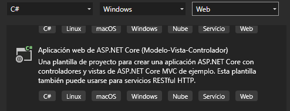
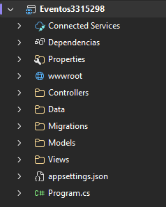
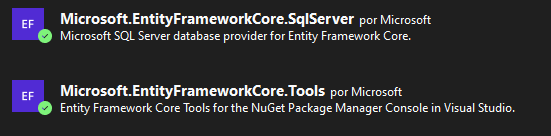

[volver a **Principal**](../principal.md)\
<sub> 21 / 10 / 2026 </sub>
# Programacion asincronica
es un modelo de ejecución que permite a un programa realizar varias tareas al mismo tiempo (o de manera concurrente) sin bloquear el flujo principal de trabajo

## en C# + .NET
### async:
modifica un metodo "firma"

**Ejemplo:**
```c#
public async Task<int> CalcularAlgoAsync() { ... }
```
### Task:
Es una clase  que envia el task

### await:
en la parte del metodo espera para continuar con otras tareas
no entendi bien como se implementa pero tengo la idea

***

# iniciar proyecto en visual Studio


**nombre del proyecto & solucion:** Eventos3315298

**Framework:** .NET 10.0

> con estas opciones seleccionadas ya viene configurado el proyecto:

 <br>
*las carpetas **Data** y **Migrations** No estan al inicio del proyecto*

## Dentro del proyecto
### Views/Shared/_Layout.cshtml
pagina unica (lo demas son componentes)

### Se renderiza en:
```cs
<div class="container">
    <main role="main" class="pb-3">
        @RenderBody()
    </main>
</div>
```
### Se va a usar: 
- [x] **Razor**
- [ ] ~~html~~

### Configuracion
1. herramientas
2. admin pack NuGet > admin pack NuGet *para la solucion*

### Instalar:
```
Microsoft.EntityFrameworkCore.SqlServer
```
```
Microsoft.EntityFrameworkCore.Tools
```

> [!IMPORTANT]
> Instalar la version `10.0`, compatible con .net 10.0


**Instalar y aceptar**

### appsettings.json
despues de **"AllowedHosts": "*",** agregar:
```json
 "ConnectionStrings": {
   "CadenaSQL": "Data Source= DESKTOP-BV9MNRK\\SQLEXPRESS;Initial Catalog= dbEventos3315298;Integrated Security=True;TrustServerCertificate=True;"
 }
```

### Programm.cs:
despues de la 1ra linea agregar:
```cs
//imports:
using Eventos3315298.Data;
using Microsoft.EntityFrameworkCore;

//1. Inyextar la cadena de conexion
builder.Services.AddDbContext<Eventos3315298Context>(options => {
    options.UseSqlServer(builder.Configuration.GetConnectionString("CadenaSQL"));
});
```

### Agregar carpeta al proyecto "Data":  

Agregar clase -> Eventos3315298Context

editar
```cs
using Microsoft.EntityFrameworkCore;

namespace Eventos3315298.Data
{
    // : = herencia
    public class Eventos3315298Context:DbContext
    {
        //agregar constructor
        public Eventos3315298Context(DbContextOptions<Eventos3315298Context> options)
            :base(options)
        {

        }
    }
}
```

### verificar si agrega db

Herramientas -> NuGet -> consola

comando:
```
Add-Migration "Inicial"
```
> sale error, *realizar paso de abajo*

## Si sale error:

desactivar errores:

doble clic en el proyecto -> xml
```xml
<PropertyGroup>
  <TargetFramework>net10.0</TargetFramework>
  <Nullable>enable</Nullable>
  <ImplicitUsings>enable</ImplicitUsings> 
 <NuGetAudit>false</NuGetAudit> //este
</PropertyGroup>
```
en la consola
```
Add-Migration "Inicial"
```
> con la base ya creada comienza creando las clases en **Model**
```
Update-Database
```

## Model
"**prop**": crea el atributo con get/set automaticamente

*prop* = public int MyProperty { get; set; }
### Municipio:
```cs
namespace Eventos3315298.Models
{
    public class Municipio
    {
        //metodos Get/Set automaticos
        public int MunicipioId {  get; set; }
        public string Nombre { get; set; } = "";
    }
}

```

## Agregar atributos al Data/...Context:
despues del contructor
```cs
//Atributos
public DbSet<Municipio> Municipios { get; set; }
```

### agregar en Data: MunicipioConfig
```cs
using Eventos3315298.Models;
using Microsoft.EntityFrameworkCore;
using Microsoft.EntityFrameworkCore.Metadata.Builders;

namespace Eventos3315298.Data
{
    public class MunicipioConfig : IEntityTypeConfiguration<Municipio>
    {
        public void Configure(EntityTypeBuilder<Municipio> builder)
        {
            builder.HasKey(col => col.MunicipioId);
            //identity = primary key | valueGenerate = auto Increment
            builder.Property(col => col.MunicipioId).UseIdentityColumn().ValueGeneratedOnAdd();
            builder.Property(col => col.Nombre).HasMaxLength(25).IsRequired();
            //HasIndex = geenra indice restrictivo "unique"
            builder.HasIndex(col => col.Nombre).IsUnique();
        }
    }
}

```

### inyectar en el contexto:
despues de los atributos que escribimos anteriormente
```cs
protected override void OnModelCreating(ModelBuilder modelBuilder)
{
    //inyectar clase de configuracion
    modelBuilder.ApplyConfiguration(new MunicipioConfig());
}
```

## Migraciones 
"Una migracion es una actualizacion a la base de datos directamente modificandola desde el Modelo"

en la consola
```
Add-Migration "Muni"
```
luego:
```
Update-Database
```
> esto actualiza la data base en Sql server