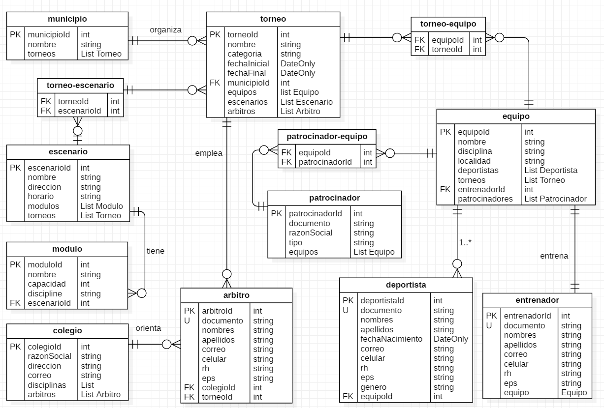

[volver a **Principal**](../principal.md)\
<center>09/11/2026</center>

# le continuation de la classe precedente
# relacion torneo y equipos:
### Torneo-model:
```cs
// relacion 1:m con equipo
public ICollection<Equipo> Equipos { get; set; } = new List<Equipo>();
```
### Equipo-model:
```cs
// relacion 1:m con torneo
public ICollection<Torneo> Torneos { get; set; } = new List<Torneo>();
```

### Equipo-config:
```cs
 // configurar relacion 1:m con torneo
 builder.HasMany(e => e.Torneos)
     .WithMany(t => t.Equipos)
     .UsingEntity(j => j.ToTable("TorneoEquipo"));
```

### **Migracion**
```
Add-Migration "TorneoEquipo"
```
# Agregar clase en model: **TorneoEquiposViewModel**
> esta clase no va a la persistencia ¬
```cs
namespace Eventos3315298.Models
{
    public class TorneoEquiposViewModel
    {
        public int TorneoId { get; set; }
        public int EquipoId { get; set; }
        public List<EquipoCheckBoxItem> EquiposDisponibles { get; set; } = new();
    }

    public class EquipoCheckBoxItem 
    {
        public int EquipoId { get; set; }
        public string NombreEquipo { get; set; } = "";
        public string Disciplina { get; set; } = "";
        public bool IsSelected { get; set; }
    }
}
```

# Torneo Controller
despues del crud:
```cs
//Registrar equipo en torneo
[HttpGet]
public async Task<IActionResult> AsignarEquipos(int? id)
{
    if (id==null)
    {
        TempData["Error"] = "No se especifico el ID del torneo";
        return RedirectToAction(nameof(Index));
    }
    //buscar los datos del torneo
    var torneo = await _context.Torneos
        .Include(t => t.Equipos)
        // si el Id que llega es igual a este: que incluya todos los equipos
        .FirstOrDefaultAsync(t=> t.TorneoId==id);
    if (torneo == null)
    {
        TempData["Error"] = "Tonreo no encontrado";
        return RedirectToAction(nameof(Index));
    }
    // si no fue null, obtener todos los equipos almacenados en db
    var todosLosEquipos = await _context.Equipos.ToListAsync();

    // armar el objeto de tipo TorneoEquiposViewModel para enviarlo a la vista

    var viewModel = new TorneoEquiposViewModel
    {
        TorneoId = torneo.TorneoId,
        TorneoNombre = torneo.Nombre,
        EquiposDisponibles = todosLosEquipos.Select(e => new EquipoCheckBoxItem
        {
            EquipoId = e.EquipoId,
            NombreEquipo = e.Nombre,
            Disciplina = e.Disciplina,
            // coloca el estado 'seleccionado' o 'no seleccionado'
            IsSelected = torneo.Equipos.Any(eq => eq.EquipoId == e.EquipoId)
        }).ToList()
    };

    return View(viewModel);
}
```

### Agregar vista (vista Vacia "AsignarEquipos"):
```html
<!-- import torneoEquipos -->
@model Eventos3315298.Models.TorneoEquiposViewModel

@{
    ViewData["Titulo"] = "Asignar Equipos";
}

<h1>Asignar Equipos</h1>
<h3>Torneo: @Model.TorneoNombre</h3>
<hr />
<!-- Nombre como metodo del controller -->
<form asp-action="AsignarEquipos" method="post">
    <!-- Manejar campos ocultos para Torneo/EquipoId -->
    <input type="hidden" asp-for="TorneoId" />
    <input type="hidden" asp-for="TorneoNombre" />
    <div class="card mb-3">
        <div class="card-header bg-primary text-white">
            Seleccione los equipos participantes
        </div>
        <div class="card-body">
            <div class="table-responsive">
                <table class="table table-striped">
                    <thead>
                        <tr>
                            <th style="width: 50px;">Inscribir</th>
                            <th>Nombre del equipo</th>
                            <th>Disciplina</th>
                        </tr>
                    </thead>
                    <tbody>
                        @for(int i=0; i<Model.EquiposDisponibles.Count; i++)
                            {
                                <tr>
                                    <td>
                                        <input type="hidden" asp-for="EquiposDisponibles[i].EquipoId" />
                                        <input type="hidden" asp-for="EquiposDisponibles[i].NombreEquipo" />
                                        <input type="checkbox" asp-for="EquiposDisponibles[i].IsSelected" 
                                                class="form-check-input"/>
                                    </td>
                                    <td>@Model.EquiposDisponibles[i].NombreEquipo</td>
                                    <td>@Model.EquiposDisponibles[i].Disciplina</td>
                                </tr>
                            }
                        </tbody>
                </table>
            </div>
        </div>
    </div>
    <div>
        <input type="submit" value="Guardar" class="btn btn-success" />
        <a asp-action="Index" class="btn btn-warning">Cancelar</a> 
    </div>
</form>
```

## HttpPost:
```cs
[HttpPost]
[ValidateAntiForgeryToken]
public async Task<IActionResult> AsignarEquipos(TorneoEquiposViewModel model)
{
    //Buscar el Torneo con sus Equipos Inscritos
    var torneo = await _context.Torneos
        .Include(t => t.Equipos)
        .FirstOrDefaultAsync(t=> t.TorneoId == model.TorneoId);
    if (torneo == null)
    {
        TempData["Error"] = "Torneo no encontrado";
        return RedirectToAction("Index");
    }

    //Mostrar como seleccionados los Equipos que pertenecen al torneo
    var idsEquiposSeleccionados = model.EquiposDisponibles
        .Where(e => e.IsSelected)
        .Select(e => e.EquipoId)
        .ToList();
    torneo.Equipos.Clear(); //refresca/actualiza la seleccion

    //modificar la seleccion (quitar o poner Equipos en el Torneo)
    if (idsEquiposSeleccionados.Any())
    {
        var equiposSeleccionados = await _context.Equipos
            .Where(e => idsEquiposSeleccionados.Contains(e.EquipoId))
            .ToListAsync();

        //Al torneo le adicionamos Equipo
        foreach(var equipo in equiposSeleccionados)
        {
            torneo.Equipos.Add(equipo);
        }
    }
    await _context.SaveChangesAsync();
    TempData["mensaje"] = "Equipos del Torneo actualizados con exito";
    return RedirectToAction(nameof(Index));
}
```

## Agregar mensaje en TorneoIndex:
```html
@if (TempData["Mensaje"] != null)
{
    <div class="alert alert-success alert-dismissible fade show" role="alert">
        @TempData["Mensaje"]
        <button type="button" class="btn-close" data-bs-dismiss="alert" aria-label="Close"></button>
    </div>
}
```

# modificacion de diagrama de clases:
- agrega **Torneo-Escenario**
- relaciona las 2 en 1:m



# Actividad
### pasar todo a Springboot *(miercoles 9-dic)*
