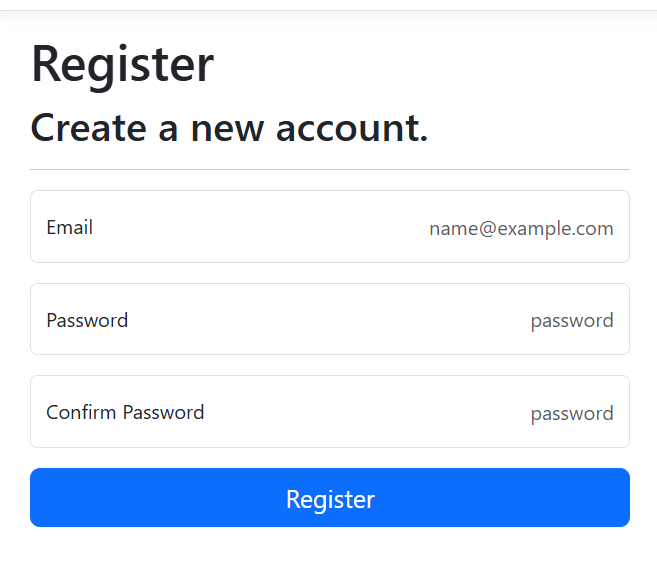
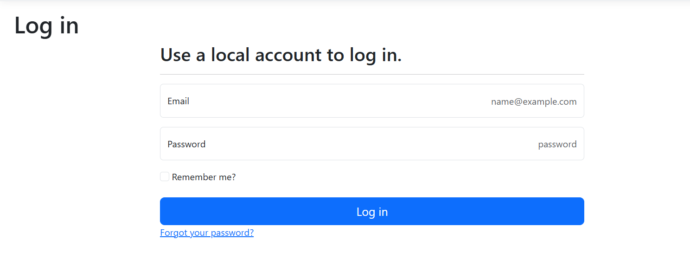

[volver a **Principal**](../principal.md)\
<center>11/11/2026</center>

# <center>***Agregar Inicio de sesion seguro al proyecto***</center>

# Crear una copia del proyecto
*Eventos###-copia* y abrirlo

## **/appsettings.json** (modificar nombre de db)
- dbEventos3315298v2

### hacer migracion
- Add-Migration "dbCopia"

# *clic derecho* en Carpeta principal **Eventos###**
- ### Editar archivo del proyecto:
dentro del "</ ItemGroup>", despues del "</ PackageReference>"
```xml
<PackageReference Include="Microsoft.AspNetCore.Identity.EntityFrameworkCore" Version="10.0.13" />
<PackageReference Include="Microsoft.AspNetCore.Identity.UI" Version="10.0.13" />
```

### Compilar

# Agregar Clase *ApplicationUser* en **Data**
Hereda *IdentityUser*
```cs
using Microsoft.AspNetCore.Identity;

namespace Eventos3315298.Data
{
    public class ApplicationUser : IdentityUser
    {
    }
}
```
# **Data/Eventos###Context**
### Cambiar herencia *DbContext*:
```cs
public class Eventos3315298Context:IdentityDbContext<ApplicationUser>
```

## metodo *OnModelCreating*
agregar:
```cs
//Insertar entidades del Membership
base.OnModelCreating(modelBuilder);
```

# **Program.cs**
agregar
### 1:
```cs
using Microsoft.AspNetCore.Identity; //1. adicionar este using
```
### 2: Despues de cadena de conexion:
```cs
//Adicionar defaultIdentity
builder.Services.AddDefaultIdentity<ApplicationUser>(options =>
{
    options.SignIn.RequireConfirmedAccount = false;
    options.Password.RequireDigit = true;
    options.Password.RequiredLength = 6;
})
.AddEntityFrameworkStores<Eventos3315298Context>();
```
### 3:  despues del *app.UseRouting();*
```cs
app.UseAuthentication();
```
### 3:  antes del *app.Run();*
```cs
app.MapRazorPages();
```

# **Views/Shared**
1. clic derecho
2. agregar vista
3. **Vista de razor: vacia**
4. *_LoginPartial*
5. *Agregar*
6. copiar el codigo:
```html
@using Microsoft.AspNetCore.Identity
@using Microsoft.AspNetCore.Identity
@using Microsoft.AspNetCore.Identity
@using Eventos3315298.Data
@inject SignInManager<ApplicationUser> SignInManager
@inject UserManager<ApplicationUser> UserManager

<ul class="navbar-nav">
    @if (SignInManager.IsSignedIn(User))
    {
        <li class="nav-item">
            <a id="manage" class="nav-link text-dark" asp-area="Identity" asp-page="/Account/Manage/Index" title="Manage">Hola @UserManager.GetUserName(User)!</a>
        </li>
        <li class="nav-item">
            <form id="logoutForm" class="form-inline" asp-area="Identity" asp-page="/Account/Logout" asp-route-returnUrl="@Url.Action("Index", "Home", new { area = "" })">
                <button id="logout" type="submit" class="nav-link btn btn-link text-dark border-0">Cerrar sesión</button>
            </form>
        </li>
    }
    else
    {
        
    <li class="nav-item">
        <a class="nav-link text-dark" id="register" asp-area="Identity" asp-page="/Account/Register">Registrarse</a>
    </li>
    
        <li class="nav-item">
            <a class="nav-link text-dark" id="login" asp-area="Identity" asp-page="/Account/Login">Iniciar sesión</a>
        </li>
    }
</ul>
```
> fuente: jose pedro

### Editar codigo:
```html
@using Microsoft.AspNetCore.Identity
@using Eventos3315298.Data
@inject SignInManager<ApplicationUser> SignInManager
@inject UserManager<ApplicationUser> UserManager

<ul class="navbar-nav">
    @if (SignInManager.IsSignedIn(User))
    {
        <li class="nav-item">
            <a id="manage" class="nav-link text-dark" asp-area="Identity" asp-page="/Account/Manage/Index" title="Manage">Hola @UserManager.GetUserName(User)!</a>
        </li>
        <li class="nav-item">
            <form id="logoutForm" class="form-inline" asp-area="Identity" asp-page="/Account/Logout" asp-route-returnUrl="@Url.Action("Index", "Home", new { area = "" })">
                <button id="logout" type="submit" class="nav-link btn btn-link text-dark border-0">Cerrar sesión</button>
            </form>
        </li>
    }
    else
    {
        @*
        <li class="nav-item">
            <a class="nav-link text-dark" id="register" asp-area="Identity" asp-page="/Account/Register">Registrarse</a>
        </li>
        *@

        <li class="nav-item">
            <a class="nav-link text-dark" id="login" asp-area="Identity" asp-page="/Account/Login">Iniciar sesión</a>
        </li>
    }
</ul>
```

# **/Eventos###**
1. clic derecho
2. agregar
3. *Nuevo ELemento Scaffold*
4. **Identidad**
5. **Agregar**
   1. Seleccionar Contexto *Eventos3315298Context (Eventos3315298.Data)*
   2. **Agregar**
> todo eso genera la carpeta *Areas* en el panel principal


# **/Vies/Shared/_Layout**
1. agregar "< ul>"  despues de la " < li>" de equipos, fuera de ese "< li>"
```html
<ul class="navbar-nav">
    <partial name="_LoginPartial" />
</ul>
```

## Hacer migracion
```
Add-Migration "tsMigration"
```
## Y actualizar db
```
Update-Database
```
> El nombre no importa, o talves si? Jose va muy rapido

### Todo esto es para agregar *Inicio de Sesion en el proyecto*


# Agregar en todos los **/Controller/?Controller**
Despues del *namespace*, antes del metodo principal
```cs
[Authorize]
```

# **\Eventos3315298\Areas\Identity\Pages\Account\Login.cshtml**
comentar estas lineas, **Para eliminar "Registrar nuevo usuario"** : 
```html
 @*
 <p>
     <a asp-page="./Register" asp-route-returnUrl="@Model.ReturnUrl">Register as a new user</a>
 </p>
 <p>
     <a id="resend-confirmation" asp-page="./ResendEmailConfirmation">Resend email confirmation</a>
 </p>
 *@
```
- eliminar "< div class="col-md-6 col-md-offset-2">" *l 51*
- cambiar div linea 10
```html
<div class="col-md-6 offset-md-2">
```

# Ejecutar y crear cuenta
## Registrar

## cuenta de este equipo:
- ### email:
```
eventosficha@sena.com
```
- ### password:
```
Eventos123*
```

## Login


# **/Controller/Municipios**
comentar *[Authorize]* principal
### [Authorize] personalizado
agregar *[Authorize]* en:
- create
- edit
- delete
despues del *[Http?]*