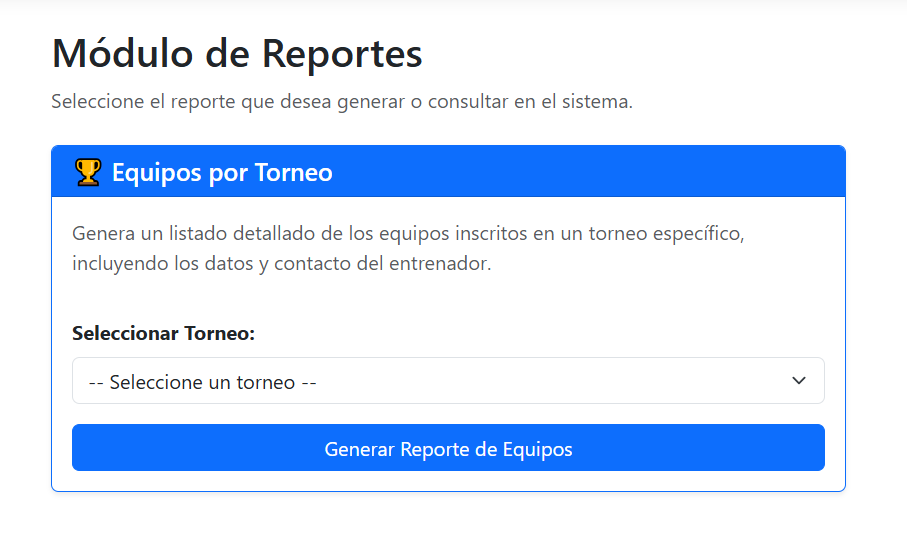
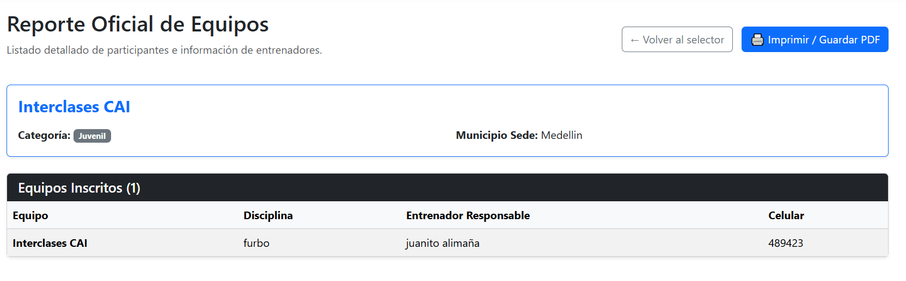

[volver a **Principal**](../principal.md)\
*18-11-2026 (ya salio gta 6)*
# <center>***Reportes***</center>
### Empezar a generar reportes, similar a INNER JOINS, tomando datos de diferentes tablas sin alterarlos, usando *DTO*
## Indice de clase
- [**Crear DTOs**](#models-crear-carpeta-dtos)
- [**Crear *Service***](#agregar-carpeta-services)
- [**Controller para Reportes**](#add-controlador-mvc-en-blanco-controller)
- [**Agregar descargar en Excel**](#edit-controllerreportescontroller)
---
---
# `/Models` **crear** carpeta *DTOs*
## **Crear** clase `TorneoEquiposReporteDTO`
```c#
namespace Eventos3315298.Models.DTOs
{
    public class TorneoEquiposReporteDTO
    {
        // Nombre de cada uno
        public int TorneoId { get; set; }
        public string NombreTorneo { get; set; } = "";
        public string CategoriaTorneo { get; set; } = "";
        public string MunicipioTorneo { get; set; } = "";
        // Lista de torneos
        public List<EquipoDetalleDTO> EquiposInscritos { get; set; } = new();
    }
}
```
## **Crear**  clase `EquipoDetalleDTO`
```c#
namespace Eventos3315298.Models.DTOs
{
    public class EquipoDetalleDTO
    {
        public int EquipoId { get; set; }
        public string NombreEquipo { get; set; } = "";
        public string Disciplina { get; set; } = "";
        public string NombreEntrenador { get; set; } = "";
        public string CelularEntrenador { get; set; } = "";
    }
}
```

# **Agregar** carpeta `Services`
## **Agregar** interfaz `IReporteService`
```cs
using Eventos3315298.Models.DTOs;

namespace Eventos3315298.Services
{
    public interface IReporteService
    {
        Task<TorneoEquiposReporteDTO?> ObtenerEquiposPorTorneo(int torneoId);
        Task<List<TorneoEquiposReporteDTO>> ObtenerTodosLosTorneosConEquipos();
    }
}
```
## **agregar** clase `ReporteService`
```cs
using Eventos3315298.Data;
using Eventos3315298.Models.DTOs;
using Microsoft.EntityFrameworkCore;

namespace Eventos3315298.Services
{
    // implementar todos los miembros de forma explicita
    public class ReporteService : IReporteService
    {
        //inyectar context
        private readonly Eventos3315298Context _context;
        // generar contructor
        public ReporteService(Eventos3315298Context context)
        {
            _context = context;
        }

        //Consultas con notacion linq
        public async Task<TorneoEquiposReporteDTO?> ObtenerEquiposPorTorneo(int torneoId)
        {
            return await _context.Torneos
                //estructura 'forEach': recorre torneoId hasta que sea igual al del metodo y lo almacena en 't'
                .Where(t => t.TorneoId == torneoId)
                //carga las entidades mencionadas
                .Include(t => t.Municipio)
                .Include(t => t.Equipos)
                    .ThenInclude(e => e.Entrenador)
                    //arma torneo y lo une con equipo
                .Select(t => new TorneoEquiposReporteDTO
                {
                    TorneoId = t.TorneoId,
                    NombreTorneo = t.Nombre,
                    CategoriaTorneo = t.Categoria,
                    MunicipioTorneo = t.Municipio != null ? t.Municipio.Nombre : "Sin asignar",
                    EquiposInscritos = t.Equipos.Select(e => new EquipoDetalleDTO
                    {
                        EquipoId = e.EquipoId,
                        NombreEquipo = e.Nombre,
                        Disciplina= e.Disciplina,
                        NombreEntrenador = e.Entrenador != null ? e.Entrenador.NombreCompleto : "Sin asignar",
                        CelularEntrenador = e.Entrenador != null ? e.Entrenador.Celular : "N/A"
                    }).ToList()
                })
                //devuelve el primer resultado que coincide
                .FirstOrDefaultAsync();
        }

        public async Task<List<TorneoEquiposReporteDTO>> ObtenerTodosLosTorneosConEquipos()
        {

            return await _context.Torneos
                .Include(t => t.Municipio)
                .Include(t => t.Equipos)
                    .ThenInclude(e => e.Entrenador)
                .Select(t => new TorneoEquiposReporteDTO
                {
                    TorneoId = t.TorneoId,
                    NombreTorneo = t.Nombre,
                    CategoriaTorneo = t.Categoria,
                    MunicipioTorneo = t.Municipio != null ? t.Municipio.Nombre : "Sin asignar",
                    EquiposInscritos = t.Equipos.Select(e => new EquipoDetalleDTO
                    {
                        EquipoId = e.EquipoId,
                        NombreEquipo = e.Nombre,
                        NombreEntrenador = e.Entrenador != null ? e.Entrenador.NombreCompleto : "Sin asignar",
                        CelularEntrenador = e.Entrenador != null ? e.Entrenador.Celular : "N/A"
                    }).ToList()
                })
                .ToListAsync();
        }
    }
}
```

# **Registrar** *servicio* en `/program.cs`
despues de `// Add services to the container.`
```cs
//Registrar el servicio
builder.Services.AddScoped<IReporteService, ReporteService>();
```

# **add** *controlador mvc: en blanco* `/Controller`
### ReportesController
```cs
using Eventos3315298.Data;
using Eventos3315298.Services;
using Microsoft.AspNetCore.Mvc;
using Microsoft.EntityFrameworkCore;

namespace Eventos3315298.Controllers
{
    public class ReportesController : Controller
    {
        private readonly IReporteService _reporteService;
        private readonly Eventos3315298Context _context;

        public ReportesController(IReporteService reporteService, Eventos3315298Context context)
        {
            _reporteService = reporteService;
            _context = context;
        }

        public async Task<IActionResult> Index()
        {
            var torneo = await _context.Torneos
                .Select(t => new { t.TorneoId, t.Nombre })
                .ToListAsync();
            ViewBag.TorneosList = torneo;
            return View();
        }

        public async Task<IActionResult> TorneoEquipos(int id)
        {
            var reporteDTO = await _reporteService.ObtenerEquiposPorTorneo(id);
            if(reporteDTO == null)
            {
                TempData["Error"] = "No se encontro el Torneo especificado";
                return RedirectToAction(nameof(Index));
            }
            return View(reporteDTO);
        }
    }
}
```
## **crear** vista `vista vacia` del *index*
### Index `ReportesController`
> Jose pedro hizo el codigo, con IA
```html
@{
    ViewData["Title"] = "Módulo de Reportes";
}

<div class="container mt-4">
    <h2>Módulo de Reportes</h2>
    <p class="text-muted">Seleccione el reporte que desea generar o consultar en el sistema.</p>

    <div class="row mt-4">
        <!-- REPORTE 1: Equipos por Torneo (Requiere Selector) -->
        <div class="col-md-6 mb-4">
            <div class="card shadow-sm h-100 border-primary">
                <div class="card-header bg-primary text-white">
                    <h5 class="mb-0">🏆 Equipos por Torneo</h5>
                </div>
                <div class="card-body d-flex flex-column justify-content-between">
                    <p class="card-text text-muted">
                        Genera un listado detallado de los equipos inscritos en un torneo específico, incluyendo los datos y contacto del entrenador.
                    </p>
                    <form asp-action="TorneoEquipos" method="get" class="mt-3">
                        <div class="mb-3">
                            <label for="id" class="form-label fw-bold">Seleccionar Torneo:</label>
                            <select name="id" class="form-select" required>
                                <option value="">-- Seleccione un torneo --</option>
                                @if (ViewBag.TorneosList != null)
                                {
                                    @foreach (var torneo in ViewBag.TorneosList)
                                    {
                                        <option value="@torneo.TorneoId">@torneo.Nombre</option>
                                    }
                                }
                            </select>
                        </div>
                        <button type="submit" class="btn btn-primary w-100">Generar Reporte de Equipos</button>
                    </form>
                </div>
            </div>
        </div>
    </div>
</div>
```
## **add** vista `vista vacia` de *TorneoEquipos*
### TorneoEquipos
```html
@model Eventos3315298.Models.DTOs.TorneoEquiposReporteDTO

@{
    ViewData["Title"] = "Reporte de Equipos por Torneo";
}

<div class="container mt-4">
    <div class="d-flex justify-content-between align-items-center mb-4">
        <div>
            <h2>Reporte Oficial de Equipos</h2>
            <p class="text-muted">Listado detallado de participantes e información de entrenadores.</p>
        </div>
        <div>
            <a asp-action="Index" class="btn btn-outline-secondary me-2">← Volver al selector</a>            
            <button onclick="window.print()" class="btn btn-primary">🖨️ Imprimir / Guardar PDF</button>
        </div>
    </div>

    <!-- Tarjeta con la Información General del Torneo -->
    <div class="card shadow-sm mb-4 border-primary">
        <div class="card-body">
            <h4 class="card-title text-primary fw-bold">@Model.NombreTorneo</h4>
            <div class="row mt-3">
                <div class="col-md-6">
                    <p class="mb-1"><strong>Categoría:</strong> <span class="badge bg-secondary">@Model.CategoriaTorneo</span></p>
                </div>
                <div class="col-md-6">
                    <p class="mb-1"><strong>Municipio Sede:</strong> @Model.MunicipioTorneo</p>
                </div>
            </div>
        </div>
    </div>

    <!-- Tabla de Equipos Inscritos -->
    <div class="card shadow-sm">
        <div class="card-header bg-dark text-white">
            <h5 class="mb-0">Equipos Inscritos (@Model.EquiposInscritos.Count)</h5>
        </div>
        <div class="card-body p-0">
            <table class="table table-striped table-hover mb-0 align-middle">
                <thead class="table-light">
                    <tr>
                        <th>Equipo</th>
                        <th>Disciplina</th>                        
                        <th>Entrenador Responsable</th>
                        <th>Celular</th>
                    </tr>
                </thead>
                <tbody>
                    @if (Model.EquiposInscritos.Any())
                    {
                        @foreach (var equipo in Model.EquiposInscritos)
                        {
                            <tr>
                                <td class="fw-bold">@equipo.NombreEquipo</td>
                                <td>@equipo.Disciplina</td>                                
                                <td>@equipo.NombreEntrenador</td>
                                <td>@equipo.CelularEntrenador</td>
                            </tr>
                        }
                    }
                    else
                    {
                        <tr>
                            <td colspan="5" class="text-center text-muted py-4">
                                No hay equipos inscritos registrados para este torneo actualmente.
                            </td>
                        </tr>
                    }
                </tbody>
            </table>
        </div>
    </div>
</div>

<!-- Estilos rápidos para optimizar la impresión en papel o PDF -->
<style>
    @@media print {
        .btn, nav, footer {
            display: none !important;
        }
        .card {
            border: none !important;
            box-shadow: none !important;
        }
    }
</style>
```

# **add** \<ul> en `_Layout`
```html
<li class="nav-item">
    <a class="nav-link text-dark" asp-area="" asp-controller="Reportes" asp-action="Index">Reportes</a>
</li>
```
# Funcionalidad de Reportes **completa**

### Reporte generado:


# **edit** vista `TorneoEquipos`
**agregar** en el primer div
```diff
<div class="d-flex justify-content-between align-items-center mb-4">
    <div>
        <h2>Reporte Oficial de Equipos</h2>
        <p class="text-muted">Listado detallado de participantes e información de entrenadores.</p>
    </div>
    <div>
        <a asp-action="Index" class="btn btn-outline-secondary me-2">← Volver al selector</a>
+       <a asp-action="ExportarExcelTorneoEquipos" asp-route-id="@Model.TorneoId" class="btn btn-outline-success me-2">Descargar Excel</a>
        <button onclick="window.print()" class="btn btn-primary">🖨️ Imprimir / Guardar PDF</button>
    </div>
</div>
```
# **edit** `Controller/ReportesController`
## implementar descarga por *Excel*
**agregar** el metodo que se agrego en la vista `ExportarExcelTorneoEquipos`
```cs
public async Task<IActionResult> ExportarExcelTorneoEquipos(int id)
{
    var reporteDto = await _reporteService.ObtenerEquiposPorTorneo(id);
    if (reporteDto == null)
    {
        TempData["Error"] = "No se encontro el Torneo especificado";
        return RedirectToAction(nameof(Index));
    }
    // StringBuilder: concatena texto sin llenar mucha memoria
    var builder = new System.Text.StringBuilder();
    //appendline: añade la linea completa, y arma los nombres
    builder.AppendLine($"TORNEO:;\"{reporteDto.NombreTorneo}\"");
    builder.AppendLine($"CATEGORIA:;\"{reporteDto.CategoriaTorneo}\"");
    builder.AppendLine($"MUNICIPIO:;\"{reporteDto.MunicipioTorneo}\"");

    //encabezados de la tabla
    builder.AppendLine("ID Equipo;Nombre Equipo;Disciplina;Entrenador;Celular Entrenador");

    //Llenar filas
    foreach (var equipo in reporteDto.EquiposInscritos)
    {
        builder.AppendLine($"{equipo.EquipoId};\"{equipo.NombreEquipo}\";\"{equipo.Disciplina}\";\"{equipo.NombreEntrenador}\";\"{equipo.CelularEntrenador}\"");
    }

    //conversion codigos UTF-8
    var preamble = System.Text.Encoding.UTF8.GetPreamble();
    var bodyBytes = System.Text.Encoding.UTF8.GetBytes(builder.ToString());
    var fileBytes = preamble.Concat(bodyBytes).ToArray();

    //generar csv
    string filename = $"Reporte_Equipo_Torneo_{id}_{DateTime.Now:yyyyMMdd_HHmm}.csv";
    return File(fileBytes,"text/csv",filename);
}
```

