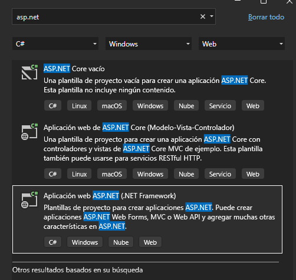
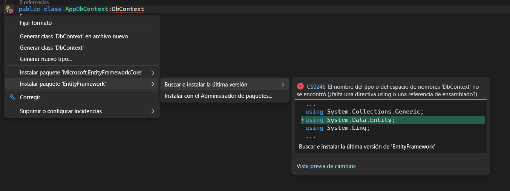

[volver a **Principal**](../principal.md)\
*25-11-2026, miercoles*
# <center>***Plantilla 2***</center>
## Indice de clase
- [**iniciar proyecto con plantilla + configuracion**](#iniciar-nuevo-proyecto)
- [**agregar context**](#add-context-en-models)
- [**agregar Modelos**](#models-add-clase-ficha)
- [**agregar controlador**](#add-controller)
- [**segunda clase**](#crear-clase-aprendiz)
---
---
# iniciar nuevo proyecto:
### Es una plantilla nueva
1. **buscar** `asp.net`
2. **Seleccionar** *Aplicacion web ASP.NET (.NET Framework)*

3. **renombrar** `ejercicioMVC`
4. *crear*
5. **Seleccionar** `MVC`
6. dejar las opciones de la derecha por defecto
7. *Crear*

## Web config (contraparte de .json)
**agregar** despues de el primer \<configuration>
```xml
<connectionStrings>
	<add name="DefaultConnection" connectionString="Data Source=./SQLEXPRESS; Initial Catalog=pruebaMVC; Integrated Security=True"
		 providerName="System.Data.SqlClient" />
</connectionStrings>
```
### **Data Source =** *Va el nombre del servidor del equipo (se ve en SQL Server Management Studio)* 
```diff
+ Data Source=./SQLEXPRESS;
```
# **Add** *Context* en `/Models`
nombre: `AppDbContext`

## agregar herencia `:DbContext`
```diff
+ public class AppDbContext:DbContext
```
### Seleccionar *instalar*
> [!IMPORTANT]
> Se necesita internet



### añadir Constructor
```cs
public AppDbContext() : base("DefaultConnection")
{

}
```

## Agregar comando herramientas nuget
### para evitar hacer migraciones constantemente
```bash
Enable-Migrations -ContextTypeName AppDbContext -EnableAutomaticMigration
```
> ### eso crea `Configuration.cs`

## agregar en el 1er contructor *Configuration*
```cs
AutomaticMigrationDataLossAllowed = true;
ContextKey = "ejercicioMVC.Models.AppDbContext";
```

# `/AppDbContext`
**agregar** despues del constructor
```cs
//Sobreescribir el metodo OnModelCreating
protected override void OnModelCreating(DbModelBuilder modelBuilder)
{
    modelBuilder.Conventions.Remove<OneToManyCascadeDeleteConvention>();
}
```

# Archivo `/Global.asax`
**agregar** en la primera linea de la funcion `protected void Application_Start()`, antes de *AreaRegistration*
```cs
Database.SetInitializer(
    new MigrateDatabaseToLatestVersion<Models.AppDbContext, Migrations.Configuration>());
```

# `/Models` **add** clase *Ficha*
```cs
using System;
using System.Collections.Generic;
using System.ComponentModel.DataAnnotations;
using System.Linq;
using System.Web;

namespace ejercicioMVC.Models
{
    public class Ficha
    {
        [Key]
        public int FichaId { get; set; }

        [Required(ErrorMessage = "El campo {0} es obligatorio")]
        [StringLength(30, MinimumLength = 6, ErrorMessage = "El campo {0} debe tener entre {2} y {1} caracteres")]
        public string Programa { get; set; } //no hace falta inicializarla

        [Required(ErrorMessage = "El campo {0} es obligatorio")]
        [StringLength(8, MinimumLength = 6, ErrorMessage = "El campo {0} debe tener entre {2} y {1} caracteres")]
        public string codigo { get; set; }

        [Required(ErrorMessage = "El campo {0} es obligatorio")]
        [DataType(DataType.Date)]
        [DisplayFormat(DataFormatString ="{0:yyyy-MM-dd}", ApplyFormatInEditMode = true)]
        public DateTime FechaInicio { get; set; }

        [Required(ErrorMessage = "El campo {0} es obligatorio")]
        [DataType(DataType.Date)]
        [DisplayFormat(DataFormatString = "{0:yyyy-MM-dd}", ApplyFormatInEditMode = true)]
        public DateTime FechaFin { get; set; }
    }
}
```

# **add** Controller
1. *Controlador MVC 5*
2. **seleccionar** *clase de modelo* ***(en este caso *ficha*)***
3. **seleccionar** *clase de contexto*
4. **agregar**

### Genera el controlador

# `/Shared/_Layout`
agregar nuevo
```html
<li>@Html.ActionLink("Fichas", "Index", "Fichas", new { area = "" }, new { @class = "nav-link" })</li>
```

> me perdi kakakakka

# **edit** `FichaController`
funcion *public ActionResult Create*
```cs
if (ModelState.IsValid)
{
    try
    {
        db.Fichas.Add(ficha);
        db.SaveChanges();
        return RedirectToAction("Index");
    }
    catch (Exception ex)
    {
        if(ex.InnerException!=null && ex.InnerException.InnerException != null 
            && ex.InnerException.InnerException.Message.Contains("IndexCodigo"))
        {
            ViewBag.ErrorCod = "Ya hay una ficha con el codigo {ficha.codigo}";
        }
        return View(ficha);
    }
}
return View(ficha);
```

## vista `/create`
**agregar**
```html
@if (ViewBag.ErrorCod != null)
{
    <p class="text-danger">
        @ViewBag.ErrorCod;
    </p>
}
```

### **aplicar lo mismo** con `edit`

> [!TIP]
> Como la app ejecuta dependiendo de en que pestaña del IDE estemos, se arregla asi
> 1. **clic derecho** en el archivo del proyecto `ejercicioMVC`
> 2. *Propiedades*
> 3. **Seleccionar** *Web\**
> 4. **Copiar** *URL del proyecto*
> 5. **Activar** **Direccion URL de inicio**
> 6. **Copiar** la url en el espacio
>
> Ahora siempre abre directo al `Index`

# Crear clase `aprendiz`
```cs
using System;
using System.Collections.Generic;
using System.ComponentModel.DataAnnotations;
using System.ComponentModel.DataAnnotations.Schema;
using System.Linq;
using System.Web;

namespace ejercicioMVC.Models
{
    public class Aprendiz
    {
        [Key]
        public int AprendizId { get; set; }

        [Required(ErrorMessage = "El campo {0} es obligatorio")]
        [StringLength(12, MinimumLength = 7, ErrorMessage = "El campo {0} debe tener entre {2} y {1} caracteres")]
        [Index("IndexDocumento", IsUnique = true)]
        public string Documento { get; set; }

        [Required(ErrorMessage = "El campo {0} es obligatorio")]
        [StringLength(30, MinimumLength = 3, ErrorMessage = "El campo {0} debe tener entre {2} y {1} caracteres")]
        public string Nombres { get; set; }

        [Required(ErrorMessage = "El campo {0} es obligatorio")]
        [StringLength(30, MinimumLength = 3, ErrorMessage = "El campo {0} debe tener entre {2} y {1} caracteres")]
        public string Apellidos { get; set; }

        [Required(ErrorMessage = "El campo {0} es obligatorio")]
        [StringLength(10, MinimumLength = 4, ErrorMessage = "El campo {0} debe tener entre {2} y {1} caracteres")]
        public string Genero { get; set; }

        [Required(ErrorMessage = "El campo {0} es obligatorio")]
        [StringLength(10, MinimumLength = 10, ErrorMessage = "El campo {0} debe tener entre {2} y {1} caracteres")]
        [Range(3000000000, 3999999999, ErrorMessage = "El campo {0} debe estar entre {1} y {2}")]
        [Index("IndexCelular", IsUnique = true)]
        public string Celular { get; set; }

        [Required(ErrorMessage = "El campo {0} es obligatorio")]
        [StringLength(50, MinimumLength = 10, ErrorMessage = "El campo {0} debe tener entre {2} y {1} caracteres")]
        [DataType(DataType.EmailAddress)]
        [Index("IndexCorreo", IsUnique = true)]
        public string Correo { get; set; }

        [Required(ErrorMessage = "El campo {0} es obligatorio")]
        [DataType(DataType.Date)]
        [DisplayFormat(DataFormatString = "{0:yyyy-MM-dd}", ApplyFormatInEditMode = true)]
        public string FechaNacimiento { get; set; }

        //llave foranea
        [Required(ErrorMessage = "El campo {0} es obligatorio")]
        public int FichaId { get; set; }
        public virtual Ficha Ficha { get; set; } //propiedad de navegacion
    }
}
```

## foranea en ficha:
```cs
//relacion con aprendiz
public virtual ICollection<Aprendiz> Aprendiz { get; set; }
```

### añadir controller `Aprendiz`
### añadir en _layout

## `AprendiszController`
### Editar lo de antes
### **Create**
```cs
public ActionResult Create([Bind(Include = "AprendizId,Documento,Nombres,Apellidos,Genero,Celular,Correo,FechaNacimiento,FichaId")] Aprendiz aprendiz)
{
    if (ModelState.IsValid)
    {
        try
        {
            db.Aprendizs.Add(aprendiz);
            db.SaveChanges();
            return RedirectToAction("Index");
        }
        catch (Exception ex)
        {
            if (ex.InnerException != null && ex.InnerException.InnerException != null
                && ex.InnerException.InnerException.Message.Contains("IndexDocumento"))
            {
                ViewBag.ErrorDoc = "Ya hay un aprendiz con el documento " + aprendiz.Documento ;
            }
            if (ex.InnerException != null && ex.InnerException.InnerException != null
                && ex.InnerException.InnerException.Message.Contains("IndexCorreo"))
            {
                ViewBag.ErrorCor = "Ya hay un aprendiz con el correo " + aprendiz.Correo;
            }
            if (ex.InnerException != null && ex.InnerException.InnerException != null
                && ex.InnerException.InnerException.Message.Contains("IndexCelular"))
            {
                ViewBag.ErrorCel = "Ya hay un aprendiz con el celular " + aprendiz.Celular;
            }
            ViewBag.FichaId = new SelectList(db.Fichas, "FichaId", "Programa", aprendiz.FichaId);
            return View(aprendiz);
        }
        
    }
    ViewBag.FichaId = new SelectList(db.Fichas, "FichaId", "Programa", aprendiz.FichaId);
    return View(aprendiz);
}
```
### Agreagr los errores en las vistas
```html
@if (ViewBag.ErrorDoc != null)
{
    <p class="text-danger">
        @ViewBag.ErrorDoc;
    </p>
}
```
```html
@if (ViewBag.ErrorCel != null)
{
    <p class="text-danger">
        @ViewBag.ErrorCel;
    </p>
}
```
```html
@if (ViewBag.ErrorCor != null)
{
    <p class="text-danger">
        @ViewBag.ErrorCor;
    </p>
}
```
en `edit` tambien
### **Edit**
```cs
public ActionResult Edit([Bind(Include = "AprendizId,Documento,Nombres,Apellidos,Genero,Celular,Correo,FechaNacimiento,FichaId")] Aprendiz aprendiz)
{
    if (ModelState.IsValid)
    {
        try
        {
            db.Entry(aprendiz).State = EntityState.Modified;
            db.SaveChanges();
            return RedirectToAction("Index");
        }
        catch (Exception ex)
        {
            if (ex.InnerException != null && ex.InnerException.InnerException != null
                && ex.InnerException.InnerException.Message.Contains("IndexDocumento"))
            {
                ViewBag.ErrorDoc = "Ya hay un aprendiz con el documento " + aprendiz.Documento;
            }
            if (ex.InnerException != null && ex.InnerException.InnerException != null
                && ex.InnerException.InnerException.Message.Contains("IndexCorreo"))
            {
                ViewBag.ErrorCor = "Ya hay un aprendiz con el correo " + aprendiz.Correo;
            }
            if (ex.InnerException != null && ex.InnerException.InnerException != null
                && ex.InnerException.InnerException.Message.Contains("IndexCelular"))
            {
                ViewBag.ErrorCel = "Ya hay un aprendiz con el celular " + aprendiz.Celular;
            }
            ViewBag.FichaId = new SelectList(db.Fichas, "FichaId", "Programa", aprendiz.FichaId);
            return View(aprendiz);
        }
        
    }
    ViewBag.FichaId = new SelectList(db.Fichas, "FichaId", "Programa", aprendiz.FichaId);
    return View(aprendiz);
}
```

# Crear un metodo en `AprendizController`
antes del dispose, al final
```cs
private List<SelectListItem> ObtenerGenero()
{
    return new List<SelectListItem>()
    {
        new SelectListItem() 
        { 
            Text = "Seleccione Genero",
            Value="Seleccionar",
            Selected = true
        },
        new SelectListItem() 
        { 
            Text = "Femenino",
            Value = "Femenino" 
        },
        new SelectListItem()
        {
            Text = "Masculino",
            Value = "Masculino"
        },
        new SelectListItem()
        {
            Text = "Otros",
            Value = "Otros"
        }
    };
}
```

## añadir `ObtenerGenero();` en:
1: create httpGet
```diff
public ActionResult Create()
{
+    ViewBag.Genero = ObtenerGenero();
     ViewBag.FichaId = new SelectList(db.Fichas, "FichaId", "Programa");
     return View();
}
```
2: create httpPost
```diff
public ActionResult Create([Bind(Include = "AprendizId,Documento,Nombres,Apellidos,Genero,Celular,Correo,FechaNacimiento,FichaId")] Aprendiz aprendiz)
{
    if (ModelState.IsValid)
    {
        try
        {
            db.Aprendizs.Add(aprendiz);
            db.SaveChanges();
            return RedirectToAction("Index");
        }
        catch (Exception ex)
        {
            if (ex.InnerException != null && ex.InnerException.InnerException != null
                && ex.InnerException.InnerException.Message.Contains("IndexDocumento"))
            {
                ViewBag.ErrorDoc = "Ya hay un aprendiz con el documento " + aprendiz.Documento;
            }
            if (ex.InnerException != null && ex.InnerException.InnerException != null
                && ex.InnerException.InnerException.Message.Contains("IndexCorreo"))
            {
                ViewBag.ErrorCor = "Ya hay un aprendiz con el correo " + aprendiz.Correo;
            }
            if (ex.InnerException != null && ex.InnerException.InnerException != null
                && ex.InnerException.InnerException.Message.Contains("IndexCelular"))
            {
                ViewBag.ErrorCel = "Ya hay un aprendiz con el celular " + aprendiz.Celular;
            }
+           ViewBag.Genero = ObtenerGenero();
            ViewBag.FichaId = new SelectList(db.Fichas, "FichaId", "Programa", aprendiz.FichaId);
            return View(aprendiz);
        }

    }
+   ViewBag.Genero = ObtenerGenero();
    ViewBag.FichaId = new SelectList(db.Fichas, "FichaId", "Programa", aprendiz.FichaId);
    return View(aprendiz);
}
```
3: edit httpGet
```diff
public ActionResult Edit(int? id)
{
+   ViewBag.Genero = ObtenerGenero();
    if (id == null)
    {
        return new HttpStatusCodeResult(HttpStatusCode.BadRequest);
    }
    Aprendiz aprendiz = db.Aprendizs.Find(id);
    if (aprendiz == null)
    {
        return HttpNotFound();
    }
    ViewBag.FichaId = new SelectList(db.Fichas, "FichaId", "Programa", aprendiz.FichaId);
    return View(aprendiz);
}
```
4: edit httpPost
```diff
public ActionResult Edit([Bind(Include = "AprendizId,Documento,Nombres,Apellidos,Genero,Celular,Correo,FechaNacimiento,FichaId")] Aprendiz aprendiz)
{
    if (ModelState.IsValid)
    {
        try
        {
            db.Entry(aprendiz).State = EntityState.Modified;
            db.SaveChanges();
            return RedirectToAction("Index");
        }
        catch (Exception ex)
        {
            if (ex.InnerException != null && ex.InnerException.InnerException != null
                && ex.InnerException.InnerException.Message.Contains("IndexDocumento"))
            {
                ViewBag.ErrorDoc = "Ya hay un aprendiz con el documento " + aprendiz.Documento;
            }
            if (ex.InnerException != null && ex.InnerException.InnerException != null
                && ex.InnerException.InnerException.Message.Contains("IndexCorreo"))
            {
                ViewBag.ErrorCor = "Ya hay un aprendiz con el correo " + aprendiz.Correo;
            }
            if (ex.InnerException != null && ex.InnerException.InnerException != null
                && ex.InnerException.InnerException.Message.Contains("IndexCelular"))
            {
                ViewBag.ErrorCel = "Ya hay un aprendiz con el celular " + aprendiz.Celular;
            }
+           ViewBag.Genero = ObtenerGenero();
            ViewBag.FichaId = new SelectList(db.Fichas, "FichaId", "Programa", aprendiz.FichaId);
            return View(aprendiz);
        }
        
    }
+   ViewBag.Genero = ObtenerGenero();
    ViewBag.FichaId = new SelectList(db.Fichas, "FichaId", "Programa", aprendiz.FichaId);
    return View(aprendiz);
}
```
## `/create` Aprendices
agregar obtener genero
1. Eliminar esta linea
```diff
<div class="form-group">
    @Html.LabelFor(model => model.Genero, htmlAttributes: new { @class = "control-label col-md-2" })
    <div class="col-md-10">
        @Html.EditorFor(model => model.Genero, new { htmlAttributes = new { @class = "form-control" } })
-        @Html.ValidationMessageFor(model => model.Genero, "", new { @class = "text-danger" })
    </div>
</div>
```
Remplazar
```cs
<div class="col-md-10">
    @Html.DropDownList("Genero", (List<SelectListItem>)ViewBag.Genero, htmlAttributes: new { @class = "form-control" })
</div>
```
Copiar todo el div completo y remplazarlo en */edit*
#### completo:
```html
<div class="form-group">
    @Html.LabelFor(model => model.Genero, htmlAttributes: new { @class = "control-label col-md-2" })
    <div class="col-md-10">
            @Html.DropDownList("Genero", (List<SelectListItem>)ViewBag.Genero, htmlAttributes: new { @class = "form-control" })
    </div>
</div>
```
>se puso a modificar los botones para que tenga color, no quise hacerlo jaaja

# **crear** clase  `Acudiente`
```cs
using System;
using System.Collections.Generic;
using System.ComponentModel.DataAnnotations;
using System.ComponentModel.DataAnnotations.Schema;
using System.Linq;
using System.Web;

namespace ejercicioMVC.Models
{
    public class Acudiente
    {
        [Key]
        public int AcudienteId { get; set; }

        [Required(ErrorMessage = "El campo {0} es obligatorio")]
        [StringLength(12, MinimumLength = 7, ErrorMessage = "El campo {0} debe tener entre {2} y {1} caracteres")]
        [Index("IndexDocumento", IsUnique = true)]
        public string Documento { get; set; }

        [Required(ErrorMessage = "El campo {0} es obligatorio")]
        [StringLength(30, MinimumLength = 3, ErrorMessage = "El campo {0} debe tener entre {2} y {1} caracteres")]
        public string Nombres { get; set; }

        [Required(ErrorMessage = "El campo {0} es obligatorio")]
        [StringLength(30, MinimumLength = 3, ErrorMessage = "El campo {0} debe tener entre {2} y {1} caracteres")]
        public string Apellidos { get; set; }

        public string FullName { get { return this.Nombres + " " + this.Apellidos; } }

        [Required(ErrorMessage = "El campo {0} es obligatorio")]
        [StringLength(10, MinimumLength = 4, ErrorMessage = "El campo {0} debe tener entre {2} y {1} caracteres")]
        public string Genero { get; set; }

        [Required(ErrorMessage = "El campo {0} es obligatorio")]
        [StringLength(10, MinimumLength = 10, ErrorMessage = "El campo {0} debe tener entre {2} y {1} caracteres")]
        [Range(3000000000, 3999999999, ErrorMessage = "El campo {0} debe estar entre {1} y {2}")]
        [Index("IndexCelular", IsUnique = true)]
        public string Celular { get; set; }

        //relacion con aprendiz
        public virtual ICollection<Aprendiz> Aprendiz { get; set; }

    }
}
```
### agregar relacion en clase `aprendiz`
```cs
//foranea de acudiente
[Required(ErrorMessage = "El campo {0} es obligatorio")]
[Index("IndexAcudienteId", IsUnique = true)]
public int AcudienteId { get; set; }
```

### **add** controlador de *acudiente*

### agregar acudiente en _layout
```html
<li>@Html.ActionLink("Acudientes", "Index", "Acudientes", new { area = "" }, new { @class = "nav-link" })</li>
```

### Copiar el metodo `ObtenerGenero` de *AprendicesController* y pegarlo en *AcudientesController*
> Llamarlo en las mismas lineas que el controller [**ver**](#crear-un-metodo-en-aprendizcontroller)

## **edit** en `acudienteController`
```cs
public ActionResult Create([Bind(Include = "AcudienteId,Documento,Nombres,Apellidos,Genero,Celular")] Acudiente acudiente)
{
    if (ModelState.IsValid)
    {
        try
        {
            db.Acudientes.Add(acudiente);
            db.SaveChanges();
            return RedirectToAction("Index");
        }
        catch (Exception ex)
        {
            if (ex.InnerException != null && ex.InnerException.InnerException != null
                && ex.InnerException.InnerException.Message.Contains("IndexDocumento"))
            {
                ViewBag.ErrorDoc = "Ya hay un acudiente con el documento " + acudiente.Documento;
            }
            if (ex.InnerException != null && ex.InnerException.InnerException != null
                && ex.InnerException.InnerException.Message.Contains("IndexCelular"))
            {
                ViewBag.ErrorCel = "Ya hay un acudiente con el celular " + acudiente.Celular;
            }
            ViewBag.Genero = ObtenerGenero();
            return View(acudiente);
        }
    }
    ViewBag.Genero = ObtenerGenero();
    return View(acudiente);
}
```
```cs
  public ActionResult Edit([Bind(Include = "AcudienteId,Documento,Nombres,Apellidos,Genero,Celular")] Acudiente acudiente)
  {
      if (ModelState.IsValid)
      {
          try
          {
              db.Entry(acudiente).State = EntityState.Modified;
              db.SaveChanges();
              return RedirectToAction("Index");
          }
          catch (Exception ex)
          {
              if (ex.InnerException != null && ex.InnerException.InnerException != null
                  && ex.InnerException.InnerException.Message.Contains("IndexDocumento"))
              {
                  ViewBag.ErrorDoc = "Ya hay un acudiente con el documento " + acudiente.Documento;
              }
              if (ex.InnerException != null && ex.InnerException.InnerException != null
                  && ex.InnerException.InnerException.Message.Contains("IndexCelular"))
              {
                  ViewBag.ErrorCel = "Ya hay un acudiente con el celular " + acudiente.Celular;
              }
              ViewBag.Genero = ObtenerGenero();
              return View(acudiente);
          }
      }
      ViewBag.Genero = ObtenerGenero();
      return View(acudiente);
  }
```
> [!NOTE]
> Son las mismas modificaciones que en *aprendiz* con algunos cambios

## `aprendices/vista/create`
traer la validacion y copiarla en `acudientes/create`\
Documento
```cs
@if (ViewBag.ErrorDoc != null)
{
    <p class="text-danger">
        @ViewBag.ErrorDoc;
    </p>
}
```
Celular
```cs
@if (ViewBag.ErrorCel != null)
{
    <p class="text-danger">
        @ViewBag.ErrorDoc;
    </p>
}
```

## igual que el genero:
```cs
<div class="form-group">
    @Html.LabelFor(model => model.Genero, htmlAttributes: new { @class = "control-label col-md-2" })
    <div class="col-md-10">
        @Html.DropDownList("Genero", (List<SelectListItem>)ViewBag.Genero, htmlAttributes: new { @class = "form-control" })
    </div>
</div>
```
> En **create** y **edit**