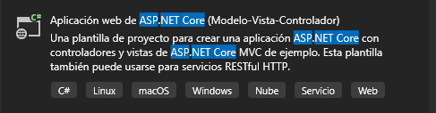

# Instalar Visual Studio
1. ejecutar el instalable
2. seleccionar:
   1. Desarrollo ASP y web 
   > plantillas de proyecto
   2. Desarrollo escritorio .net
   > herramientas de desarrollo 4.8
3. **Instalar** (11-12 Gb)
4. Cerrar el instalador
5. buscar el ejecutable
6. iniciar la aplicacion
7. login
8. Configuracion de desarrollo
   1. desarrollo web

## dentro de la app
> por ahora se visualiza sin descargar
1. crear un proyecto
2. seleccionar
   1. Todos los lenguajes -> c#
   2. todas las plataformas -> windows
   3. buscar: asp .
   - [X] ASP net core (modelo-vista-controlador)
  
   

   1. ASP .net (framework) "despues"

# Instalar SQL Server, Express edition (22)
> **No** se va a usar esta version

1. basic
2. accept
3. install
4. intall SSMS [pagina de descarga](https://learn.microsoft.com/en-us/ssms/install/install?redirectedfrom=MSDN)
5. instalar
   1. seleccionar "hibrido y por defecto"
   2. instalar
   3. cerrar 
6. buscar en el incio "management" (Sql server management Studio 22)
7. login

# SQL SSMS 20.2.1
- [pagina de descarga](https://www.filehorse.com/es/download-sql-server-studio/94102/download/)
1. install
2. ejecutar management studio
3. mandatory -> Opcional
4. **Conectar**