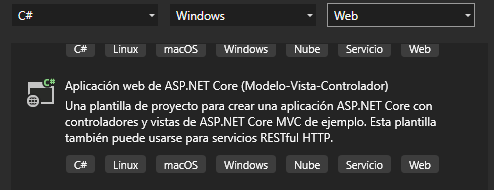
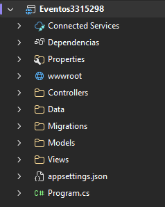
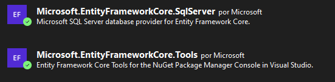
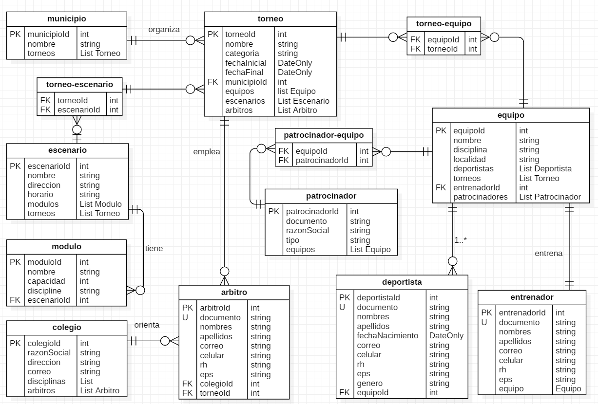
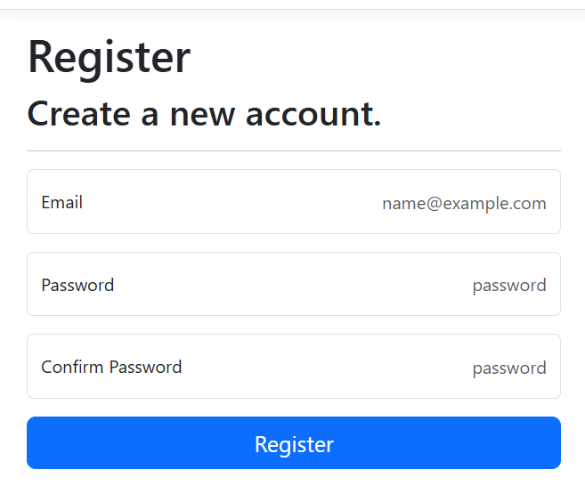
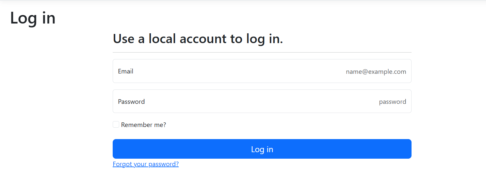

[volver al readme](README.md)
# **Clases de .net**
>[!IMPORTANT]
> nose si poner indice que pereza, si este mensaje sigue es por que no lo he hecho xdxd

<sub> 21 / 10 / 2026 </sub>
***

# Programacion asincronica
es un modelo de ejecución que permite a un programa realizar varias tareas al mismo tiempo (o de manera concurrente) sin bloquear el flujo principal de trabajo

## en C# + .NET
### async:
modifica un metodo "firma"

**Ejemplo:**
```c#
public async Task<int> CalcularAlgoAsync() { ... }
```
### Task:
Es una clase  que envia el task

### await:
en la parte del metodo espera para continuar con otras tareas
no entendi bien como se implementa pero tengo la idea

***

# iniciar proyecto en visual Studio


**nombre del proyecto & solucion:** Eventos3315298

**Framework:** .NET 10.0

> con estas opciones seleccionadas ya viene configurado el proyecto:

 <br>
*las carpetas **Data** y **Migrations** No estan al inicio del proyecto*

## Dentro del proyecto
### Views/Shared/_Layout.cshtml
pagina unica (lo demas son componentes)

### Se renderiza en:
```cs
<div class="container">
    <main role="main" class="pb-3">
        @RenderBody()
    </main>
</div>
```
### Se va a usar: 
- [x] **Razor**
- [ ] ~~html~~

### Configuracion
1. herramientas
2. admin pack NuGet > admin pack NuGet *para la solucion*

### Instalar:


Instalar y aceptar

### appsettings.json
despues de **"AllowedHosts": "*",** agregar:
```json
 "ConnectionStrings": {
   "CadenaSQL": "Data Source= DESKTOP-BV9MNRK\\SQLEXPRESS;Initial Catalog= dbEventos3315298;Integrated Security=True;TrustServerCertificate=True;"
 }
```

### Programm.cs:
despues de la 1ra linea agregar:
```cs
//imports:
using Eventos3315298.Data;
using Microsoft.EntityFrameworkCore;

//1. Inyextar la cadena de conexion
builder.Services.AddDbContext<Eventos3315298Context>(options => {
    options.UseSqlServer(builder.Configuration.GetConnectionString("CadenaSQL"));
});
```

### Agregar carpeta al proyecto "Data":  

Agregar clase -> Eventos3315298Context

editar
```cs
using Microsoft.EntityFrameworkCore;

namespace Eventos3315298.Data
{
    // : = herencia
    public class Eventos3315298Context:DbContext
    {
        //agregar constructor
        public Eventos3315298Context(DbContextOptions<Eventos3315298Context> options)
            :base(options)
        {

        }
    }
}
```

### verificar si agrega db

Herramientas -> NuGet -> consola

comando:
```
Add-Migration "Inicial"
```
> sale error, *realizar paso de abajo*

## Si sale error:

desactivar errores:

doble clic en el proyecto -> xml
```xml
<PropertyGroup>
  <TargetFramework>net10.0</TargetFramework>
  <Nullable>enable</Nullable>
  <ImplicitUsings>enable</ImplicitUsings> 
 <NuGetAudit>false</NuGetAudit> //este
</PropertyGroup>
```
en la consola
```
Add-Migration "Inicial"
```
> con la base ya creada comienza creando las clases en **Model**
```
Update-Database
```

## Model
"**prop**": crea el atributo con get/set automaticamente

*prop* = public int MyProperty { get; set; }
### Municipio:
```cs
namespace Eventos3315298.Models
{
    public class Municipio
    {
        //metodos Get/Set automaticos
        public int MunicipioId {  get; set; }
        public string Nombre { get; set; } = "";
    }
}

```

## Agregar atributos al Data/...Context:
despues del contructor
```cs
//Atributos
public DbSet<Municipio> Municipios { get; set; }
```

### agregar en Data: MunicipioConfig
```cs
using Eventos3315298.Models;
using Microsoft.EntityFrameworkCore;
using Microsoft.EntityFrameworkCore.Metadata.Builders;

namespace Eventos3315298.Data
{
    public class MunicipioConfig : IEntityTypeConfiguration<Municipio>
    {
        public void Configure(EntityTypeBuilder<Municipio> builder)
        {
            builder.HasKey(col => col.MunicipioId);
            //identity = primary key | valueGenerate = auto Increment
            builder.Property(col => col.MunicipioId).UseIdentityColumn().ValueGeneratedOnAdd();
            builder.Property(col => col.Nombre).HasMaxLength(25).IsRequired();
            //HasIndex = geenra indice restrictivo "unique"
            builder.HasIndex(col => col.Nombre).IsUnique();
        }
    }
}

```

### inyectar en el contexto:
despues de los atributos que escribimos anteriormente
```cs
protected override void OnModelCreating(ModelBuilder modelBuilder)
{
    //inyectar clase de configuracion
    modelBuilder.ApplyConfiguration(new MunicipioConfig());
}
```

## Migraciones 
"Una migracion es una actualizacion a la base de datos directamente modificandola desde el Modelo"

en la consola
```
Add-Migration "Muni"
```
luego:
```
Update-Database
```
> esto actualiza la data base en Sql server

<center> 26/10/2026 </center>

no hay internet pog lo tanto algunas cosas no se van a ver bien y no llego a copiar por mucho dolor penal

## crear controlador
1. carpeta Controllers
2. agreagar > controlador
3. Controlador MVC en blanco
4. nombre: MunicipioController
> recomendable usar la palabra **Controller** para el nombre

Inyectar contexto en el controller
```cs
using Eventos3315298.Data;
using Microsoft.AspNetCore.Mvc;

namespace Eventos3315298.Controllers
{
    public class MunicipioController : Controller
    {
        //Inyectar contexto
        private readonly Eventos3315298Context _context;

        public MunicipioControler(Eventos3315298Context context)
        {
            _context = context;
        }
        public IActionResult Index()
        {
            return View();
        }
    }
}
```
> **"_context":** el _ inicial es para evitar una palabra reservada

## Creando el controller
```cs
[HttpGet] //obtener
public async Task<IActionResult> Index()
{
    var municipios = await _context.Municipios.ToListAsync();
    return View(municipios);
}
```

## crear vista:
1. clic dercho en el nombre del controler
2. agregar vista
3. Vista de razor
4. plantilla: index
5. clase de modelo: **clase del model**

## modificar _Layout.cshtml
>Ubicacion: Shared > *doble clic* > _Layout

**copia una lista y modifica:**
```html
<li class="nav-item">
    <a class="nav-link text-dark" asp-area="" asp-controller="Municipio" asp-action="Index">Municipio</a>
</li>
```

## MunicipioController completo
agrega **Edit, Details, Delete**
```cs
using Eventos3315298.Data;
using Eventos3315298.Models;
using Microsoft.AspNetCore.Mvc;
using Microsoft.Data.SqlClient;
using Microsoft.EntityFrameworkCore;

namespace Eventos3315298.Controllers
{
    public class MunicipioController : Controller
    {
        //Inyectar contexto
        private readonly Eventos3315298Context _context;

        public MunicipioController(Eventos3315298Context context)
        {
            _context = context;
        } 

        [HttpGet] //obtener
        public async Task<IActionResult> Index()
        {
            var municipios = await _context.Municipios.ToListAsync();
            return View(municipios);
        }

        [HttpGet] //crear vista
        public IActionResult Create()
        {
            return View();
        }

        [HttpPost] //crear
        [ValidateAntiForgeryToken]
        public async Task<IActionResult> Create(Municipio municipio)
        {
            if (!ModelState.IsValid)
            {
                return View(municipio);
            }
            try
            {
                _context.Municipios.Add(municipio);
                await _context.SaveChangesAsync();
                TempData["Mensaje"] = "Municipio creado con exiti";
                return RedirectToAction(nameof(Index));
            }
            catch (DbUpdateException e)
            {
                if (e.InnerException is SqlException sqlEx && (sqlEx.Number == 2627 || sqlEx.Number == 2601))
                {
                    if (sqlEx.Message.Contains("IX_Municipios_Nombre"))
                    {
                        ModelState.AddModelError(nameof(municipio.Nombre), "Ya existe un Municipio con este nombre");
                    }
                    else
                    {
                        ModelState.AddModelError(string.Empty, "Ocurrio un error en la base de datos");
                    }
                }
                else
                {
                    ModelState.AddModelError(string.Empty, "Ocurrio un error inesperado");
                }
            }
            return View(municipio);
        }

        [HttpGet] //editar vista
        public async Task<IActionResult> Edit(int? id)
        {
            if (id == null)
            {
                return RedirectToAction(nameof(Index));
            }
            var municipio = await _context.Municipios.FindAsync(id);
            if (municipio == null)
            {
                return RedirectToAction(nameof(Index));
            }
            return View(municipio);
        }

        [HttpPost] //editar 
        [ValidateAntiForgeryToken]
        public async Task<IActionResult> Edit(Municipio municipio)
        {
            if (!ModelState.IsValid)
            {
                return View(municipio);
            }
            try
            {
                _context.Municipios.Update(municipio);
                await _context.SaveChangesAsync();
                TempData["Mensaje"] = "Municipio modificado con exiti";
                return RedirectToAction(nameof(Index));
            }
            catch (DbUpdateException e)
            {
                if (e.InnerException is SqlException sqlEx && (sqlEx.Number == 2627 || sqlEx.Number == 2601))
                {
                    if (sqlEx.Message.Contains("IX_Municipios_Nombre"))
                    {
                        ModelState.AddModelError(nameof(municipio.Nombre), "Ya existe un Municipio con este nombre");
                    }
                    else
                    {
                        ModelState.AddModelError(string.Empty, "Ocurrio un error en la base de datos");
                    }
                }
                else
                {
                    ModelState.AddModelError(string.Empty, "Ocurrio un error inesperado");
                }
            }
            return View(municipio);
        }

        [HttpGet] //details
        public async Task<IActionResult> Details(int id)
        {
            var municipio = await _context.Municipios.FindAsync(id);
            if (municipio != null)
            {
                return View(municipio);
            }
            return RedirectToAction(nameof(Index));
        }
         
        [HttpGet] //eliminar vista
        public async Task<IActionResult> Delete(int? id)
        {
            var municipio = await _context.Municipios.FindAsync(id);
            if (municipio != null)
            {
                return View(municipio);
            }
            return RedirectToAction(nameof(Index));
        }

        /*
        [HttpPost,ActionName("Delete")]
        [ValidateAntiForgeryToken]
        public async Task<IActionResult> DeletConfirmed(int id)
        {
            var municipio = await _context.Municipios.FindAsync(id);
            if (municipio == null)
            {
                return RedirectToAction(nameof(Index));
            }
            try
            {
                _context.Municipios.Remove(municipio);
                await _context.SaveChangesAsync();
                TempData["mensaje"] = "Municipio eliminado correctamente";
            }
            catch (DbUpdateException ex)
            {
                if (ex.InnerException is SqlException sqlEx && sqlEx.Number == 547)
                {
                    TempData["Error"] = "El Municipio tiene torneos activos. No se puede eliminar";
                }
                else
                {
                    TempData["Error"] = "No se puede eliminar, Error inesperado";
                }
            }
            return RedirectToAction(nameof(Index));
        }
        */

        [HttpPost] //eliminar
        [ValidateAntiForgeryToken]
        public async Task<IActionResult> Delete(int id)
        {
            var municipio = await _context.Municipios.FindAsync(id);
            if (municipio == null)
            {
                return RedirectToAction(nameof(Index));
            }
            try
            {
                _context.Municipios.Remove(municipio);
                await _context.SaveChangesAsync();
                TempData["mensaje"] = "Municipio eliminado correctamente";
            }
            catch (DbUpdateException ex)
            {
                if (ex.InnerException is SqlException sqlEx && sqlEx.Number == 547)
                {
                    TempData["Error"] = "El Municipio tiene torneos activos. No se puede eliminar";
                }
                else
                {
                    TempData["Error"] = "No se puede eliminar, Error inesperado";
                }
            }
            return RedirectToAction(nameof(Index));
        }
    }
}

```

# clase Torneo
```cs
namespace Eventos3315298.Models
{
    public class Torneo
    {
        public int TorneoId { get; set; }
        public string Nombre { get; set; } = "";
        public string Categoria { get; set; } = "";
        public DateOnly FechaInicio { get; set; }
        public DateOnly FechaFin { get; set; }

        //relacion con municipio

        public int MunicipioId { get; set; }
        public Municipio? Municipio { get; set; }
    }
}
```
## EventosContext:
```cs
public DbSet<Torneo> Torneos { get; set; }
```
## TorneoConfig.cs
```cs
using Eventos3315298.Models;
using Microsoft.EntityFrameworkCore;
using Microsoft.EntityFrameworkCore.Metadata.Builders;

namespace Eventos3315298.Data
{
    public class TorneoConfig : IEntityTypeConfiguration<Torneo>
    {
        public void Configure(EntityTypeBuilder<Torneo> builder)
        {
            builder.HasKey(col => col.TorneoId);
            builder.Property(col => col.TorneoId)
                .UseIdentityColumn()
                .ValueGeneratedOnAdd();
            builder.Property(col => col.Nombre)
                .HasMaxLength(20)
                .IsRequired();
            builder.HasIndex(col => col.Nombre)
                .IsUnique();
            builder.Property(col => col.Categoria)
                .HasMaxLength(20)
                .IsRequired();
            builder.Property(col => col.FechaInicio)
                .IsRequired();
            builder.Property(col => col.FechaFin)
                .IsRequired();

            //configurar la relacion
            builder.HasOne(t => t.Municipio)
                .WithMany(m => m.Torneos)
                .HasForeignKey(t => t.MunicipioId)
                .OnDelete(DeleteBehavior.Restrict);
        }
    }
}
```
### realizar migracion

fin de la clase, os espero la proxima chavales, Enhorabuena!

<center>28/10/2026</center>

# TorneoController
```cs
using Eventos3315298.Data;
using Eventos3315298.Models;
using Microsoft.AspNetCore.Mvc;
using Microsoft.AspNetCore.Mvc.Rendering;
using Microsoft.Data.SqlClient;
using Microsoft.EntityFrameworkCore;

namespace Eventos3315298.Controllers
{
    public class TorneoController : Controller
    {
        private readonly Eventos3315298Context _context;

        public TorneoController(Eventos3315298Context context)
        {
            _context = context;
        }

        [HttpGet]
        public async Task<IActionResult> Index()
        {
            List<Torneo> torneos = await _context.Torneos
                .Include(t => t.Municipio)
                .ToListAsync();

            return View(torneos);
        }

        [HttpGet]
        public async Task<IActionResult> Create()
        {
            //trae toda la lista de municipios
            ViewBag.MunicipioId= new SelectList(await _context.Municipios.ToListAsync(),
                                "MunicipioId","Nombre");
            return View();
        }

        [HttpPost]
        [ValidateAntiForgeryToken]
        public async Task<IActionResult> Create(Torneo torneo)
        {
            if (!ModelState.IsValid)
            {
                ViewBag.MunicipioId = new SelectList(await _context.Municipios.ToListAsync(),
                                "MunicipioId", "Nombre", torneo.MunicipioId);
                return View(torneo);
            }
            try
            {
                _context.Torneos.Add(torneo);
                await _context.SaveChangesAsync();
                return RedirectToAction("Index");
            }
            catch (DbUpdateException e)
            {
                if(e.InnerException is SqlException sqlE && (sqlE.Number == 2627 || sqlE.Number == 2601))
                {
                    if (sqlE.Message.Contains("IX_Torneos_Nombre"))
                    {
                        ModelState.AddModelError(nameof(torneo.Nombre), "ya existe un Torneo con este nombre");
                    }
                    else
                    {
                        ModelState.AddModelError(nameof(torneo.Nombre), "Error general en la base de datos");
                    }
                }
                else
                {
                    ModelState.AddModelError(nameof(torneo.Nombre), "Ocurrio un error inesperado");
                }
            }
            ViewBag.MunicipioId = new SelectList(await _context.Municipios.ToListAsync(),
                               "MunicipioId", "Nombre", torneo.MunicipioId);
            return View(torneo);
        }

        [HttpGet]
        public async Task<IActionResult> Edit(int? id)
        {
            if (id == null)
            {
                return RedirectToAction(nameof(Index));
            }
            var torneo = await _context.Torneos.FindAsync(id);
            if (torneo==null)
            {
                TempData["Error"] = "Torneo no encontrado";
                return RedirectToAction(nameof(Index));
            }
            ViewBag.MunicipioId = new SelectList(await _context.Municipios.ToListAsync(),
                              "MunicipioId", "Nombre", torneo.MunicipioId);
            return View(torneo);
        }

        [HttpPost]
        [ValidateAntiForgeryToken]
        public async Task<IActionResult> Edit(Torneo torneo)
        {
            if (!ModelState.IsValid)
            {
                ViewBag.MunicipioId = new SelectList(await _context.Municipios.ToListAsync(),
                                "MunicipioId", "Nombre", torneo.MunicipioId);
                return View(torneo);
            }
            try
            {
                _context.Torneos.Update(torneo);
                await _context.SaveChangesAsync();
                return RedirectToAction("Index");
            }
            catch (DbUpdateException e)
            {
                if (e.InnerException is SqlException sqlE && (sqlE.Number == 2627 || sqlE.Number == 2601))
                {
                    if (sqlE.Message.Contains("IX_Torneos_Nombre"))
                    {
                        ModelState.AddModelError(nameof(torneo.Nombre), "ya existe un Torneo con este nombre");
                    }
                    else
                    {
                        ModelState.AddModelError(nameof(torneo.Nombre), "Error general en la base de datos");
                    }
                }
                else
                {
                    ModelState.AddModelError(nameof(torneo.Nombre), "Ocurrio un error inesperado");
                }
            }
            ViewBag.MunicipioId = new SelectList(await _context.Municipios.ToListAsync(),
                               "MunicipioId", "Nombre", torneo.MunicipioId);
            return View(torneo);
        }

        [HttpGet]
        public async Task<IActionResult> Details(int? id)
        {
            if (id == null)
            {
                return RedirectToAction(nameof(Index));
            }
            var torneo = await _context.Torneos.FindAsync(id);
            if (torneo == null)
            {
                TempData["Error"] = "Torneo no encontrado";
                return RedirectToAction(nameof(Index));
            }
            ViewBag.MunicipioId = new SelectList(await _context.Municipios.ToListAsync(),
                              "MunicipioId", "Nombre", torneo.MunicipioId);
            return View(torneo);
        }

        [HttpPost]
        [ValidateAntiForgeryToken]
        public async Task<IActionResult> Delete(int id)
        {
            var torneo = await _context.Torneos.FindAsync(id);
            if(torneo == null)
            {
                TempData["Error"] = "Torneo no existe";
                return RedirectToAction(nameof(Index));
            }
            try
            {
                _context.Torneos.Remove(torneo);
                await _context.SaveChangesAsync();
                return RedirectToAction(nameof(Index));
            }
            catch (DbUpdateException e)
            {
                if (e.InnerException is SqlException sqlE && sqlE.Number == 547)
                {
                    TempData["Error"] = "No se puede eliminar, Torneo con registros asociados";
                }
                else
                {
                    TempData["Error"] = "Error inesperado, intente nuevamente";
                }
                return RedirectToAction(nameof(Index));
            }
        }
    }
}

```
---
<center>04/11/2026</center>

# Corregir mensaje de error (view/municipio/index)
despues de *create new*
```cs
@* Capturar los errores enviados con el TempData *@
@if(TempData["Error"] != null)
{
    <div class="alert alert-success alert-dismissible fade show" role="alert">
        @TempData["Error"]
        <button type="button" class="btn-close" data-bs-dismiss="alert" aria-label="Close"></button>
    </div>
}
```

# nueva clase **Entrenador**
```cs
namespace Eventos3315298.Models
{
    public class Entrenador
    {
        public int EntrenadorId { get; set; }
        public string Documento { get; set; } = "";
        public string Nombres { get; set; } = null!;
        public string Apellidos { get; set; } = null!;
        public string Correo { get; set; } = null!;
        public string Celular { get; set; } = null!;
        public string Rh { get; set; } = null!;
        public string Eps { get; set; } = null!;

        //realacion 1:1 con equipo
        public Equipo? Equipo { get; set; } = null!;
    }
}
```

# clase **Equipo**
```cs
namespace Eventos3315298.Models
{
    public class Equipo
    {
        public int EquipoId { get; set; }
        public string Nombre { get; set; } = null!;
        public string Disciplina { get; set; } = null!;
        public string Localidad { get; set; } = null!;

        // llave foranea para la relacion con entrenador
        public int EntrenadorId { get; set; }
        public Entrenador? Entrenador { get; set; } = null!; //propiedad navigacional
    }
}
```

## context (EventosContext)
despues de los DbSet Anteriores
```cs
public DbSet<Entrenador> Entrenadores { get; set; }
public DbSet<Equipo> Equipos { get; set; }
```
inyecccion **(metodo OnModelCreating)**
```cs
modelBuilder.ApplyConfiguration(new EntrenadorConfig());
modelBuilder.ApplyConfiguration(new EquipoConfig());
```

## EntrenadorConfig
```cs
using Eventos3315298.Models;
using Microsoft.EntityFrameworkCore;
using Microsoft.EntityFrameworkCore.Metadata.Builders;

namespace Eventos3315298.Data
{
    public class EntrenadorConfig : IEntityTypeConfiguration<Entrenador>
    {
            public void Configure(EntityTypeBuilder<Entrenador> builder)
            {
                builder.HasKey(col => col.EntrenadorId);
                builder.Property(col => col.EntrenadorId)
                    .UseIdentityColumn()
                    .ValueGeneratedOnAdd();

                builder.Property(col => col.Documento)
                    .HasMaxLength(10)
                    .IsRequired();
                builder.HasIndex(col => col.Documento)
                    .IsUnique();

                builder.Property(col => col.Nombres)
                    .HasMaxLength(30)
                    .IsRequired();

                builder.Property(col => col.Apellidos)
                    .IsRequired();

                builder.Property(col => col.Correo)
                    .IsRequired();
                builder.HasIndex(col => col.Correo)
                    .IsUnique();

                builder.Property(col => col.Celular)
                    .HasMaxLength (10)
                    .IsRequired();
                builder.HasIndex(col => col.Celular)
                    .IsUnique();

                builder.Property(col => col.Rh)
                    .HasMaxLength(3)
                    .IsRequired();

                builder.Property(col => col.Eps)
                    .HasMaxLength(15)
                    .IsRequired();
        }
    }
}
```

## EquipoConfig
```cs
using Eventos3315298.Models;
using Microsoft.EntityFrameworkCore;
using Microsoft.EntityFrameworkCore.Metadata.Builders;

namespace Eventos3315298.Data
{
    public class EquipoConfig : IEntityTypeConfiguration<Equipo>
    {
            public void Configure(EntityTypeBuilder<Equipo> builder)
            {
                builder.HasKey(col => col.EquipoId);
                builder.Property(col => col.EquipoId)
                    .UseIdentityColumn()
                    .ValueGeneratedOnAdd();

                builder.Property(col => col.Nombre)
                    .HasMaxLength(20)
                    .IsRequired();
                builder.HasIndex(col => col.Nombre)
                    .IsUnique();

                builder.Property(col => col.Disciplina)
                    .HasMaxLength(20)
                    .IsRequired();

                builder.Property(col => col.Localidad)
                    .HasMaxLength(20)
                    .IsRequired();

                builder.Property(col => col.EntrenadorId)
                    .IsRequired();

                //configurar la relacion
                builder.HasOne(eq=>eq.Entrenador)
                    .WithOne(en=>en.Equipo)
                    .HasForeignKey<Equipo>(eq=>eq.EntrenadorId)
                    .OnDelete(DeleteBehavior.Restrict);
        }
    }
}
```

### Actualizar base de datos
consola nuGet
```
Add-Migration "entrenadoryequipo"
```
```
Update-Database
```
***
# EntrenadorController
```cs
using Eventos3315298.Data;
using Eventos3315298.Migrations;
using Eventos3315298.Models;
using Microsoft.AspNetCore.Mvc;
using Microsoft.Data.SqlClient;
using Microsoft.EntityFrameworkCore;

namespace Eventos3315298.Controllers
{
    public class EntrenadorController : Controller
    {
        private readonly Eventos3315298Context _context;

        public EntrenadorController(Eventos3315298Context context)
        {
            _context = context;
        }

        public async Task<IActionResult> Index()
        {
            var entrenadores = await _context.Entrenadores.ToListAsync();
            return View(entrenadores);
        }

        [HttpGet]
        public IActionResult Create()
        {
            return View();
        }

        [HttpPost]
        [ValidateAntiForgeryToken]
        public async Task<IActionResult> Create(Entrenador entrenador)
        {
            if (!ModelState.IsValid)
            {
                return View(entrenador);
            }
            try
            {
                _context.Entrenadores.Add(entrenador);
                await _context.SaveChangesAsync();
                return RedirectToAction("Index");
            }
            catch (DbUpdateException e)
            {
                if (e.InnerException is SqlException sqlE && (sqlE.Number == 2627 || sqlE.Number == 2601))
                {
                    if (sqlE.Message.Contains("IX_Entrenadores_Documento"))
                    {
                        ModelState.AddModelError(nameof(entrenador.Documento), "ya existe un Entrenador con este Documento");
                    }
                    else if (sqlE.Message.Contains("IX_Entrenadores_Celular"))
                    {
                        ModelState.AddModelError(nameof(entrenador.Celular), "ya existe un Entrenador con este Celular");
                    }
                    else if (sqlE.Message.Contains("IX_Entrenadores_Correo"))
                    {
                        ModelState.AddModelError(nameof(entrenador.Correo), "ya existe un Entrenador con este Correo");
                    }
                    else
                    {
                        ModelState.AddModelError(string.Empty, "Error general en la base de datos");
                    }
                }
                else
                {
                    ModelState.AddModelError(string.Empty, "Ocurrio un error inesperado");
                }
            }

            return View(entrenador);
        }

        [HttpGet]
        public async Task<IActionResult> Edit(int? id)
        {
            var entrenador = await _context.Entrenadores.FindAsync(id);
            if (entrenador == null)
            {
                return RedirectToAction(nameof(Index));
            }
            return View(entrenador);
        }

        [HttpPost]
        [ValidateAntiForgeryToken]
        public async Task<IActionResult> Edit(Entrenador entrenador)
        {
            if (!ModelState.IsValid)
            {
                return View(entrenador);
            }
            try
            {
                _context.Entrenadores.Update(entrenador);
                await _context.SaveChangesAsync();
                return RedirectToAction("Index");
            }
            catch (DbUpdateException e)
            {
                if (e.InnerException is SqlException sqlE && (sqlE.Number == 2627 || sqlE.Number == 2601))
                {
                    if (sqlE.Message.Contains("IX_Entrenadores_Documento"))
                    {
                        ModelState.AddModelError(nameof(entrenador.Documento), "ya existe un Entrenador con este Documento");
                    }
                    else if (sqlE.Message.Contains("IX_Entrenadores_Celular"))
                    {
                        ModelState.AddModelError(nameof(entrenador.Celular), "ya existe un Entrenador con este Celular");
                    }
                    else if (sqlE.Message.Contains("IX_Entrenadores_Correo"))
                    {
                        ModelState.AddModelError(nameof(entrenador.Correo), "ya existe un Entrenador con este Correo");
                    }
                    else
                    {
                        ModelState.AddModelError(string.Empty, "Error general en la base de datos");
                    }
                }
                else
                {
                    ModelState.AddModelError(string.Empty, "Ocurrio un error inesperado");
                }
            }

            return View(entrenador);
        }

        [HttpGet]
        public async Task<IActionResult> Details(int? id)
        {
            var entrenador = await _context.Entrenadores.FindAsync(id);
            if (entrenador == null)
            {
                return RedirectToAction(nameof(Index));
            }
            return View(entrenador);
        }

        [HttpPost]
        [ValidateAntiForgeryToken]
        public async Task<IActionResult> Delete(int id)
        {
            var entrenador = await _context.Entrenadores.FindAsync(id);
            if (entrenador==null)
            {
                TempData["Error"] = "Entrenador no existe";
                return RedirectToAction(nameof(Index));
            }
            try
            {
                _context.Entrenadores.Remove(entrenador);
                await _context.SaveChangesAsync();
            }
            catch (DbUpdateException e)
            {
                if (e.InnerException is SqlException sqlE && sqlE.Number == 547)
                {
                    TempData["Error"] = "No se puede eliminar, Entrenador con registros asociados";
                }
                else
                {
                    TempData["Error"] = "Error inesperado, intente nuevamente";
                }
            }
            return RedirectToAction(nameof(Index));
        }

    }
}
```

### Agregar vistas 
- [X] Index
- [X] Create
- [X] Edit
- [X] Details
- [X] Delete

# _Layout
```html
<li class="nav-item">
    <a class="nav-link text-dark" asp-area="" asp-controller="Entrenador" asp-action="Index">Entrenadores</a>
</li>
```

> borrar los **form Equipo** del: *index, create, edit, details*

## Agrega en index, remplazo de equipo form:
```cs
<td>
    <a asp-action="Edit" asp-route-id="@item.EntrenadorId" class="btn btn-primary">Edit</a>
    <a asp-action="Details" asp-route-id="@item.EntrenadorId" class="btn btn-info">Details</a>
    <!-- formulario para eliminar con js -->
    <form asp-action="Delete" asp-route-id="@item.EntrenadorId" method="post" style="display:inline;"
          onsubmit="return confirm('Estais seguros de eliminar vuestro registro?');">
        @Html.AntiForgeryToken()
        <button type="submit" class="btn btn-danger">Delete</button>
    </form>
</td>
```
## Agregar capturador de datos en el index:
despues de *create new*
```cs
@* Capturar los errores enviados con el TempData *@
@if (TempData["Error"] != null)
{
    <div class="alert alert-success alert-dismissible fade show" role="alert">
        @TempData["Error"]
        <button type="button" class="btn-close" data-bs-dismiss="alert" aria-label="Close"></button>
    </div>
}
```

# EquipoController:
```cs
using Eventos3315298.Data;
using Eventos3315298.Models;
using Microsoft.AspNetCore.Mvc;
using Microsoft.AspNetCore.Mvc.Rendering;
using Microsoft.Data.SqlClient;
using Microsoft.EntityFrameworkCore;

namespace Eventos3315298.Controllers
{
    public class EquipoController : Controller
    {
        private readonly Eventos3315298Context _context;

        public EquipoController(Eventos3315298Context context)
        {
            _context = context;
        }

        [HttpGet]
        public async Task<IActionResult> Index()
        {
            List<Equipo> equipos = await _context.Equipos
                .Include(e => e.Entrenador)
                .ToListAsync();
            return View(equipos);
        }

        [HttpGet]
        public async Task<IActionResult> Create()
        {
            ViewBag.EntrenadorId = new SelectList(await _context.Entrenadores.ToListAsync(),
                                                    "EntrenadorId", "NombreCompleto");
            return View();
        }

        [HttpGet]
        [ValidateAntiForgeryToken]
        public async Task<IActionResult> Create(Equipo equipo)
        {
            if (!ModelState.IsValid)
            {
                ViewBag.EntrenadorId = new SelectList(await _context.Entrenadores.ToListAsync(),
                                                    "EntrenadorId", "NombreCompleto", equipo.EntrenadorId);
                return View(equipo);
            }
            try
            {
                _context.Equipos.Add(equipo);
                await _context.SaveChangesAsync();
                return RedirectToAction("Index");
            }
            catch (DbUpdateException e)
            {
                if (e.InnerException is SqlException sqlE && (sqlE.Number == 2627 || sqlE.Number == 2601))
                {
                    if (sqlE.Message.Contains("IX_Equipos_Nombre"))
                    {
                        ModelState.AddModelError(nameof(equipo.Nombre), "ya existe un Equipo con este Nombre");
                    }
                    else
                    {
                        ModelState.AddModelError(string.Empty, "Error general en la base de datos");
                    }
                }
                else
                {
                    ModelState.AddModelError(string.Empty, "Ocurrio un error inesperado");
                }
            }
            ViewBag.EntrenadorId = new SelectList(await _context.Entrenadores.ToListAsync(),
                                                    "EntrenadorId", "NombreCompleto", equipo.EntrenadorId);
            return View(equipo);
        }
    }
}

```

## _layout:
```cs
@model IEnumerable<Eventos3315298.Models.Equipo>

@{
    ViewData["Title"] = "Index";
}

<h1>Index</h1>

<p>
    <a asp-action="Create">Create New</a>
</p>
<table class="table">
    <thead>
        <tr>
            <th>
                @Html.DisplayNameFor(model => model.Nombre)
            </th>
            <th>
                @Html.DisplayNameFor(model => model.Disciplina)
            </th>
            <th>
                @Html.DisplayNameFor(model => model.Localidad)
            </th>
            <th>
                @Html.DisplayNameFor(model => model.Entrenador.NombreCompleto)
            </th>
            <th></th>
        </tr>
    </thead>
    <tbody>
@foreach (var item in Model) {
        <tr>
            <td>
                @Html.DisplayFor(model => item.Nombre)
            </td>
            <td>
                @Html.DisplayFor(model => item.Disciplina)
            </td>
            <td>
                @Html.DisplayFor(model => item.Localidad)
            </td
            <td>
                @Html.DisplayFor(model => item.Entrenador.NombreCompleto)
            </td>
            <td>
                <a asp-action="Edit" asp-route-id="@item.EquipoId" class="btn btn-primary">Edit</a>
                    <a asp-action="Details" asp-route-id="@item.EquipoId" class="btn btn-info">Details</a>
                    <a asp-action="Delete" asp-route-id="@item.EquipoId" class="btn btn-danger">Delete</a>
            </td>
        </tr>
}
    </tbody>
</table>
```

### Crear vista **Create**:
```cs
@model Eventos3315298.Models.Torneo

@{
    ViewData["Title"] = "Create";
}

<h1>Create</h1>

<h4>Torneo</h4>
<hr />
<div class="row">
    <div class="col-md-4">
        <form asp-action="Create">
            <div asp-validation-summary="ModelOnly" class="text-danger"></div>

            <div class="form-group">
                <label asp-for="Nombre" class="control-label"></label>
                <input asp-for="Nombre" class="form-control" />
                <span asp-validation-for="Nombre" class="text-danger"></span>
            </div>

            <div class="form-group">
                <label asp-for="Categoria" class="control-label"></label>
                <input asp-for="Categoria" class="form-control" />
                <span asp-validation-for="Categoria" class="text-danger"></span>
            </div>

            <div class="form-group">
                <label asp-for="FechaInicio" class="control-label"></label>
                <input asp-for="FechaInicio" class="form-control" type="date"/>
                <span asp-validation-for="FechaInicio" class="text-danger"></span>
            </div>

            <div class="form-group">
                <label asp-for="FechaFin" class="control-label"></label>
                <input asp-for="FechaFin" class="form-control" type="date"/>
                <span asp-validation-for="FechaFin" class="text-danger"></span>
            </div>

            <div class="form-group">
                <label asp-for="MunicipioId" class="control-label">Municipio</label>
                <select asp-for="MunicipioId" class="form-control" asp-items="ViewBag.MunicipioId">
                    <option value=""> - Seleccione un municipio - </option>
                </select>
                <span asp-validation-for="MunicipioId" class="text-danger"></span>
            </div>
            <br />
            <div class="form-group">
                <input type="submit" value="Create" class="btn btn-primary" />
                <a asp-action="Index" class="btn btn-warning">Back to List</a>
            </div>
        </form>
    </div>
</div>

```

<center>09/11/2026</center>

# le continuation de la classe precedente
# relacion torneo y equipos:
### Torneo-model:
```cs
// relacion 1:m con equipo
public ICollection<Equipo> Equipos { get; set; } = new List<Equipo>();
```
### Equipo-model:
```cs
// relacion 1:m con torneo
public ICollection<Torneo> Torneos { get; set; } = new List<Torneo>();
```

### Equipo-config:
```cs
 // configurar relacion 1:m con torneo
 builder.HasMany(e => e.Torneos)
     .WithMany(t => t.Equipos)
     .UsingEntity(j => j.ToTable("TorneoEquipo"));
```

### **Migracion**
```
Add-Migration "TorneoEquipo"
```
# Agregar clase en model: **TorneoEquiposViewModel**
> esta clase no va a la persistencia ¬
```cs
namespace Eventos3315298.Models
{
    public class TorneoEquiposViewModel
    {
        public int TorneoId { get; set; }
        public int EquipoId { get; set; }
        public List<EquipoCheckBoxItem> EquiposDisponibles { get; set; } = new();
    }

    public class EquipoCheckBoxItem 
    {
        public int EquipoId { get; set; }
        public string NombreEquipo { get; set; } = "";
        public string Disciplina { get; set; } = "";
        public bool IsSelected { get; set; }
    }
}
```

# Torneo Controller
despues del crud:
```cs
//Registrar equipo en torneo
[HttpGet]
public async Task<IActionResult> AsignarEquipos(int? id)
{
    if (id==null)
    {
        TempData["Error"] = "No se especifico el ID del torneo";
        return RedirectToAction(nameof(Index));
    }
    //buscar los datos del torneo
    var torneo = await _context.Torneos
        .Include(t => t.Equipos)
        // si el Id que llega es igual a este: que incluya todos los equipos
        .FirstOrDefaultAsync(t=> t.TorneoId==id);
    if (torneo == null)
    {
        TempData["Error"] = "Tonreo no encontrado";
        return RedirectToAction(nameof(Index));
    }
    // si no fue null, obtener todos los equipos almacenados en db
    var todosLosEquipos = await _context.Equipos.ToListAsync();

    // armar el objeto de tipo TorneoEquiposViewModel para enviarlo a la vista

    var viewModel = new TorneoEquiposViewModel
    {
        TorneoId = torneo.TorneoId,
        TorneoNombre = torneo.Nombre,
        EquiposDisponibles = todosLosEquipos.Select(e => new EquipoCheckBoxItem
        {
            EquipoId = e.EquipoId,
            NombreEquipo = e.Nombre,
            Disciplina = e.Disciplina,
            // coloca el estado 'seleccionado' o 'no seleccionado'
            IsSelected = torneo.Equipos.Any(eq => eq.EquipoId == e.EquipoId)
        }).ToList()
    };

    return View(viewModel);
}
```

### Agregar vista (vista Vacia "AsignarEquipos"):
```html
<!-- import torneoEquipos -->
@model Eventos3315298.Models.TorneoEquiposViewModel

@{
    ViewData["Titulo"] = "Asignar Equipos";
}

<h1>Asignar Equipos</h1>
<h3>Torneo: @Model.TorneoNombre</h3>
<hr />
<!-- Nombre como metodo del controller -->
<form asp-action="AsignarEquipos" method="post">
    <!-- Manejar campos ocultos para Torneo/EquipoId -->
    <input type="hidden" asp-for="TorneoId" />
    <input type="hidden" asp-for="TorneoNombre" />
    <div class="card mb-3">
        <div class="card-header bg-primary text-white">
            Seleccione los equipos participantes
        </div>
        <div class="card-body">
            <div class="table-responsive">
                <table class="table table-striped">
                    <thead>
                        <tr>
                            <th style="width: 50px;">Inscribir</th>
                            <th>Nombre del equipo</th>
                            <th>Disciplina</th>
                        </tr>
                    </thead>
                    <tbody>
                        @for(int i=0; i<Model.EquiposDisponibles.Count; i++)
                            {
                                <tr>
                                    <td>
                                        <input type="hidden" asp-for="EquiposDisponibles[i].EquipoId" />
                                        <input type="hidden" asp-for="EquiposDisponibles[i].NombreEquipo" />
                                        <input type="checkbox" asp-for="EquiposDisponibles[i].IsSelected" 
                                                class="form-check-input"/>
                                    </td>
                                    <td>@Model.EquiposDisponibles[i].NombreEquipo</td>
                                    <td>@Model.EquiposDisponibles[i].Disciplina</td>
                                </tr>
                            }
                        </tbody>
                </table>
            </div>
        </div>
    </div>
    <div>
        <input type="submit" value="Guardar" class="btn btn-success" />
        <a asp-action="Index" class="btn btn-warning">Cancelar</a> 
    </div>
</form>
```

## HttpPost:
```cs
[HttpPost]
[ValidateAntiForgeryToken]
public async Task<IActionResult> AsignarEquipos(TorneoEquiposViewModel model)
{
    //Buscar el Torneo con sus Equipos Inscritos
    var torneo = await _context.Torneos
        .Include(t => t.Equipos)
        .FirstOrDefaultAsync(t=> t.TorneoId == model.TorneoId);
    if (torneo == null)
    {
        TempData["Error"] = "Torneo no encontrado";
        return RedirectToAction("Index");
    }

    //Mostrar como seleccionados los Equipos que pertenecen al torneo
    var idsEquiposSeleccionados = model.EquiposDisponibles
        .Where(e => e.IsSelected)
        .Select(e => e.EquipoId)
        .ToList();
    torneo.Equipos.Clear(); //refresca/actualiza la seleccion

    //modificar la seleccion (quitar o poner Equipos en el Torneo)
    if (idsEquiposSeleccionados.Any())
    {
        var equiposSeleccionados = await _context.Equipos
            .Where(e => idsEquiposSeleccionados.Contains(e.EquipoId))
            .ToListAsync();

        //Al torneo le adicionamos Equipo
        foreach(var equipo in equiposSeleccionados)
        {
            torneo.Equipos.Add(equipo);
        }
    }
    await _context.SaveChangesAsync();
    TempData["mensaje"] = "Equipos del Torneo actualizados con exito";
    return RedirectToAction(nameof(Index));
}
```

## Agregar mensaje en TorneoIndex:
```html
@if (TempData["Mensaje"] != null)
{
    <div class="alert alert-success alert-dismissible fade show" role="alert">
        @TempData["Mensaje"]
        <button type="button" class="btn-close" data-bs-dismiss="alert" aria-label="Close"></button>
    </div>
}
```

# modificacion de diagrama de clases:
- agrega **Torneo-Escenario**
- relaciona las 2 en 1:m



# Actividad
### pasar todo a Springboot *(miercoles 9-dic)*

***
<center>09/11/2026</center>

# <center>***Agregar Inicio de sesion seguro al proyecto***</center>

# Crear una copia del proyecto
*Eventos###-copia* y abrirlo

## **/appsettings.json** (modificar nombre de db)
- dbEventos3315298v2

### hacer migracion
- Add-Migration "dbCopia"

# *clic derecho* en Carpeta principal **Eventos###**
- ### Editar archivo del proyecto:
dentro del "</ ItemGroup>", despues del "</ PackageReference>"
```xml
<PackageReference Include="Microsoft.AspNetCore.Identity.EntityFrameworkCore" Version="10.0.13" />
<PackageReference Include="Microsoft.AspNetCore.Identity.UI" Version="10.0.13" />
```

### Compilar

# Agregar Clase *ApplicationUser* en **Data**
Hereda *IdentityUser*
```cs
using Microsoft.AspNetCore.Identity;

namespace Eventos3315298.Data
{
    public class ApplicationUser : IdentityUser
    {
    }
}
```
# **Data/Eventos###Context**
### Cambiar herencia *DbContext*:
```cs
public class Eventos3315298Context:IdentityDbContext<ApplicationUser>
```

## metodo *OnModelCreating*
agregar:
```cs
//Insertar entidades del Membership
base.OnModelCreating(modelBuilder);
```

# **Program.cs**
agregar
### 1:
```cs
using Microsoft.AspNetCore.Identity; //1. adicionar este using
```
### 2: Despues de cadena de conexion:
```cs
//Adicionar defaultIdentity
builder.Services.AddDefaultIdentity<ApplicationUser>(options =>
{
    options.SignIn.RequireConfirmedAccount = false;
    options.Password.RequireDigit = true;
    options.Password.RequiredLength = 6;
})
.AddEntityFrameworkStores<Eventos3315298Context>();
```
### 3:  despues del *app.UseRouting();*
```cs
app.UseAuthentication();
```
### 3:  antes del *app.Run();*
```cs
app.MapRazorPages();
```

# **Views/Shared**
1. clic derecho
2. agregar vista
3. **Vista de razor: vacia**
4. *_LoginPartial*
5. *Agregar*
6. copiar el codigo:
```html
@using Microsoft.AspNetCore.Identity
@using Microsoft.AspNetCore.Identity
@using Microsoft.AspNetCore.Identity
@using Eventos3315298.Data
@inject SignInManager<ApplicationUser> SignInManager
@inject UserManager<ApplicationUser> UserManager

<ul class="navbar-nav">
    @if (SignInManager.IsSignedIn(User))
    {
        <li class="nav-item">
            <a id="manage" class="nav-link text-dark" asp-area="Identity" asp-page="/Account/Manage/Index" title="Manage">Hola @UserManager.GetUserName(User)!</a>
        </li>
        <li class="nav-item">
            <form id="logoutForm" class="form-inline" asp-area="Identity" asp-page="/Account/Logout" asp-route-returnUrl="@Url.Action("Index", "Home", new { area = "" })">
                <button id="logout" type="submit" class="nav-link btn btn-link text-dark border-0">Cerrar sesión</button>
            </form>
        </li>
    }
    else
    {
        
    <li class="nav-item">
        <a class="nav-link text-dark" id="register" asp-area="Identity" asp-page="/Account/Register">Registrarse</a>
    </li>
    
        <li class="nav-item">
            <a class="nav-link text-dark" id="login" asp-area="Identity" asp-page="/Account/Login">Iniciar sesión</a>
        </li>
    }
</ul>
```
> fuente: jose pedro

### Editar codigo:
```html
@using Microsoft.AspNetCore.Identity
@using Eventos3315298.Data
@inject SignInManager<ApplicationUser> SignInManager
@inject UserManager<ApplicationUser> UserManager

<ul class="navbar-nav">
    @if (SignInManager.IsSignedIn(User))
    {
        <li class="nav-item">
            <a id="manage" class="nav-link text-dark" asp-area="Identity" asp-page="/Account/Manage/Index" title="Manage">Hola @UserManager.GetUserName(User)!</a>
        </li>
        <li class="nav-item">
            <form id="logoutForm" class="form-inline" asp-area="Identity" asp-page="/Account/Logout" asp-route-returnUrl="@Url.Action("Index", "Home", new { area = "" })">
                <button id="logout" type="submit" class="nav-link btn btn-link text-dark border-0">Cerrar sesión</button>
            </form>
        </li>
    }
    else
    {
        @*
        <li class="nav-item">
            <a class="nav-link text-dark" id="register" asp-area="Identity" asp-page="/Account/Register">Registrarse</a>
        </li>
        *@

        <li class="nav-item">
            <a class="nav-link text-dark" id="login" asp-area="Identity" asp-page="/Account/Login">Iniciar sesión</a>
        </li>
    }
</ul>
```

# **/Eventos###**
1. clic derecho
2. agregar
3. *Nuevo ELemento Scaffold*
4. **Identidad**
5. **Agregar**
   1. Seleccionar Contexto *Eventos3315298Context (Eventos3315298.Data)*
   2. **Agregar**
> todo eso genera la carpeta *Areas* en el panel principal


# **/Vies/Shared/_Layout**
1. agregar "< ul>"  despues de la " < li>" de equipos, fuera de ese "< li>"
```html
<ul class="navbar-nav">
    <partial name="_LoginPartial" />
</ul>
```

## Hacer migracion
```
Add-Migration "tsMigration"
```
## Y actualizar db
```
Update-Database
```
> El nombre no importa, o talves si? Jose va muy rapido

### Todo esto es para agregar *Inicio de Sesion en el proyecto*


# Agregar en todos los **/Controller/?Controller**
Despues del *namespace*, antes del metodo principal
```cs
[Authorize]
```

# **\Eventos3315298\Areas\Identity\Pages\Account\Login.cshtml**
comentar estas lineas, **Para eliminar "Registrar nuevo usuario"** : 
```html
 @*
 <p>
     <a asp-page="./Register" asp-route-returnUrl="@Model.ReturnUrl">Register as a new user</a>
 </p>
 <p>
     <a id="resend-confirmation" asp-page="./ResendEmailConfirmation">Resend email confirmation</a>
 </p>
 *@
```
- eliminar "< div class="col-md-6 col-md-offset-2">" *l 51*
- cambiar div linea 10
```html
<div class="col-md-6 offset-md-2">
```

# Ejecutar y crear cuenta
## Registrar

## cuenta de este equipo:
- ### email:
```
eventosficha@sena.com
```
- ### password:
```
Eventos123*
```

## Login


# **/Controller/Municipios**
comentar *[Authorize]* principal
### [Authorize] personalizado
agregar *[Authorize]* en:
- create
- edit
- delete
despues del *[Http?]*
